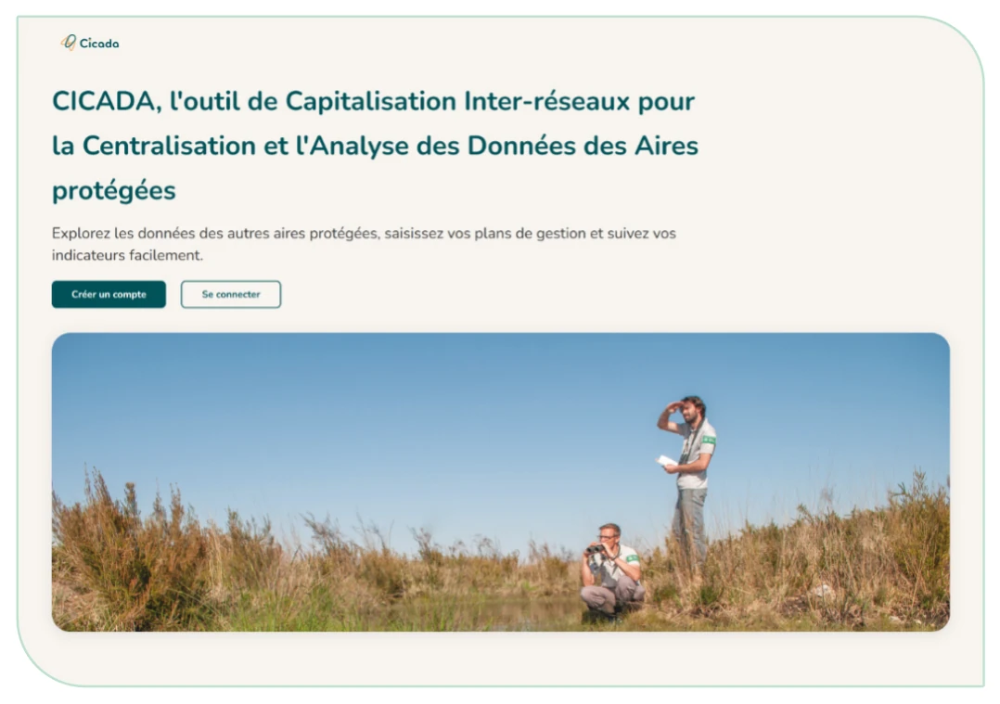
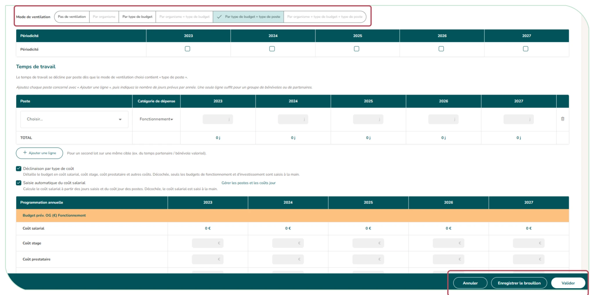
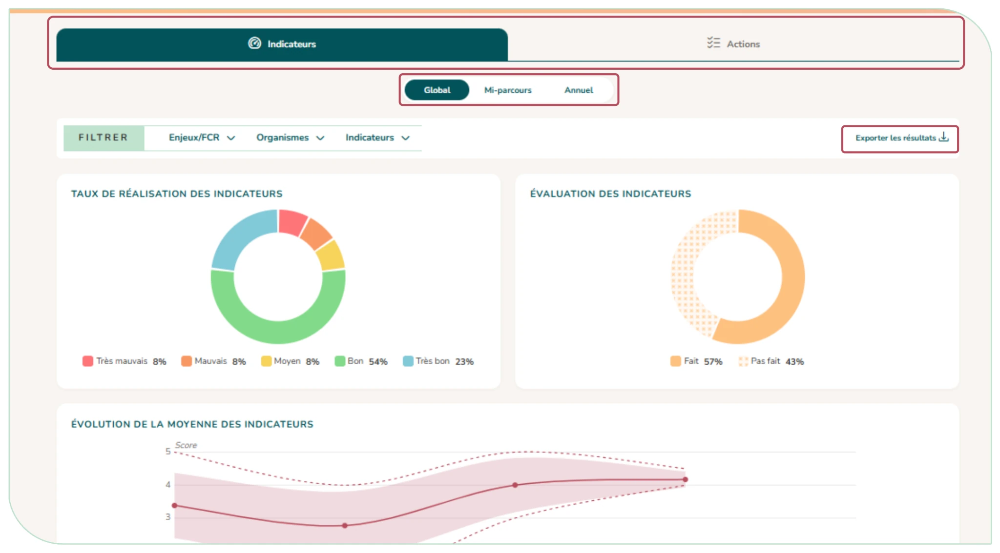
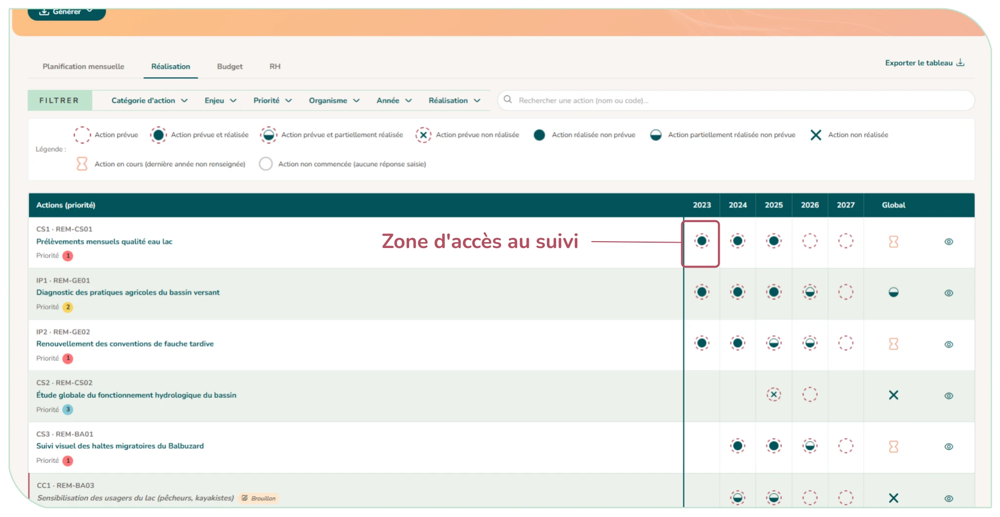
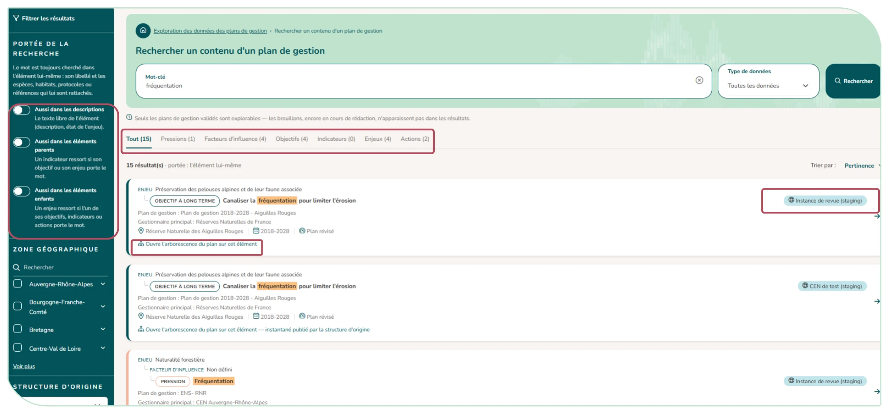
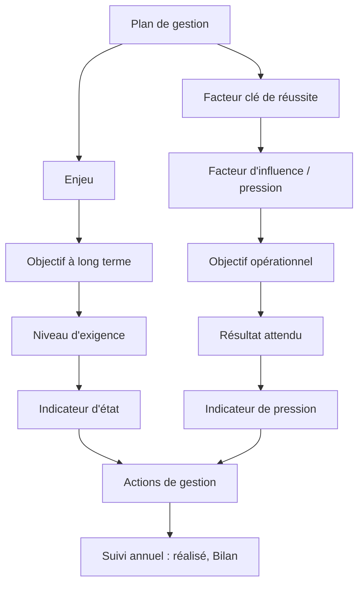
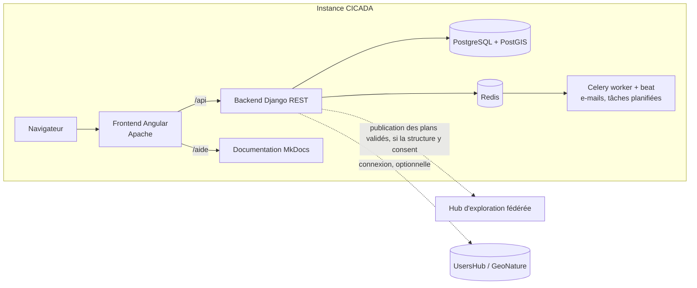
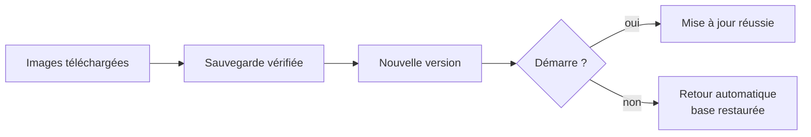

# 🌿 CICADA

**CICADA** est une application web open source pour **saisir, suivre et partager les plans de gestion des aires protégées** selon la méthodologie CT88. Elle est développée par **Réserves Naturelles de France (RNF)** et la **Fédération des Conservatoires d'espaces naturels (FCEN)**, dans le cadre du programme européen LIFE Biodiv'France.

<p align="center">
  
</p>

> 📄 Présentation du projet (contexte, objectifs, périmètre) : [Présentation_projet_CICADA_VF.pdf](docs/Présentation_projet_CICADA_VF.pdf)
> 📚 Documentation complète : servie par chaque instance sous `/aide/` — en local, `docker compose up docs` puis http://localhost:8001. Point d'entrée dans le dépôt : [docs/README.md](docs/README.md).

---

## Ce que fait CICADA

| | |
|---|---|
| **Structurer un plan de gestion** | Enjeux et facteurs clés de réussite, objectifs à long terme et opérationnels, indicateurs avec grilles de scores, actions de gestion. |
| **Programmer les actions** | Calendrier, budget et temps de travail par année ou sur la période, ventilés par organisme, type de budget ou poste ; financeurs. |
| **Suivre la réalisation** | Saisie annuelle du réalisé, planification de l'année ajustée, tableau de bord et Bilan graphique. |
| **Produire les documents** | Fiche du plan (Word), fiches action (Excel / Word), budget et RH, fiches de suivi ; classeurs réimportables. |
| **Explorer** | Recherche dans le contenu des plans validés, sur son instance ou sur toutes les instances reliées au hub. |
| **Administrer** | Organismes, sites (avec cartographie), comptes et rôles, demandes d'accès, référentiels nationaux versionnés. |

<table>
<tr>
<td width="50%"><br/><sub>Saisie d'une action de gestion</sub></td>
<td width="50%"><br/><sub>Bilan de la gestion</sub></td>
</tr>
<tr>
<td width="50%"><br/><sub>Suivi des actions, année par année</sub></td>
<td width="50%"><br/><sub>Exploration des données</sub></td>
</tr>
</table>

### Un plan de gestion dans CICADA



---

## Architecture



| Couche | Technologies |
|--------|--------------|
| Backend | Django 5.2, Django REST Framework, Celery, JWT |
| Frontend | Angular 22, Angular Material, Leaflet, design system maison ([DESIGN_SYSTEM.md](docs/DESIGN_SYSTEM.md)) |
| Données | PostgreSQL 17 / PostGIS 3.5, Redis ; référentiels INPN (TaxRef, HabRef, CAMPanule), GestRef, PressRef |
| Livraison | Images Docker (GHCR), paquet Debian avec installeur web et mise à jour par bouton |

Plusieurs instances (RNF, un CEN, une DREAL…) gardent chacune leur base ; le **hub** rassemble leurs index pour une exploration nationale. Chaque instance décide de partager ou non. Détail : [docs/fonctionnalites/21-federation.md](docs/fonctionnalites/21-federation.md).

---

## Lancer CICADA en local

**Prérequis** : Docker 20.10+ avec Docker Compose v2, Git.

```bash
git clone https://github.com/RNF-SI/Cicada.git
cd Cicada
docker compose up -d                                       # ~1 min au premier lancement
docker compose exec web python manage.py seed_testdata     # jeu d'essai (facultatif)
```

| Service | Adresse |
|---------|---------|
| Application | http://localhost:4200 |
| API | http://localhost:8000/api/ — documentation interactive : http://localhost:8000/api/docs/ |
| Administration Django | http://localhost:8000/admin/ (`admin` / `admin`) |
| E-mails de test (Mailpit) | http://localhost:8025 |
| Documentation | http://localhost:8001 (`docker compose up docs`) |

Comptes du jeu d'essai : `admin@test.fr`, `referent.camargue@test.fr`, `user.rnf@test.fr`… mot de passe `Test123!` (liste complète dans [CLAUDE.md](CLAUDE.md#test-data-available-via-python-managepy-seed_testdata)).

Le fichier `.env` est **facultatif en développement** : les valeurs par défaut de `docker-compose.yml` suffisent. Pour changer un port déjà pris (80, 5432, 8000…), copiez `.env.example` en `.env` et modifiez `FRONTEND_PORT`, `POSTGRES_EXTERNAL_PORT`, `DJANGO_PORT`…

```bash
docker compose logs -f web      # suivre le backend
docker compose down             # arrêter
docker compose build            # reconstruire après un changement de dépendances
```

> ⚠️ Les identifiants du dépôt (`docker-compose.yml`, `.env.example`) sont **réservés au développement**. En production, l'installeur génère une `SECRET_KEY` et des mots de passe propres à l'instance.

---

## Installer une instance en production

Le déploiement passe par un **paquet Debian** et un **installeur web** (Debian 12+ / Ubuntu 22.04+) :

```bash
curl -fsSL https://apt.cicada.reserves-naturelles.org/install.sh | sudo bash
# puis ouvrir http://votre-serveur:4567 et suivre le formulaire
```

La mise à jour se fait ensuite **par un bouton** dans *Administration › Mise à jour* : sauvegarde vérifiée de la base, puis retour automatique à la version précédente si l'application ne redémarre pas.



Guides : [installation](documentation/docs/administration/installation.md), [infrastructure](documentation/docs/administration/infrastructure.md), [releases](documentation/docs/administration/releases.md).

---

## Développer

| Je veux… | Lire |
|----------|------|
| comprendre une fonctionnalité | [docs/FONCTIONNALITES.md](docs/FONCTIONNALITES.md) |
| connaître les conventions et commandes | [docs/GUIDE_DEVELOPPEUR.md](docs/GUIDE_DEVELOPPEUR.md), [CLAUDE.md](CLAUDE.md) |
| toucher à l'interface | [docs/DESIGN_SYSTEM.md](docs/DESIGN_SYSTEM.md) (obligatoire) |
| écrire ou lancer des tests | [docs/TESTING.md](docs/TESTING.md) |
| publier une version | [docs/RELEASE_PIPELINE.md](docs/RELEASE_PIPELINE.md) |

**Contribuer** : branche depuis `develop`, commits au format [Conventional Commits](https://www.conventionalcommits.org/) (`feat(plans): …`, `fix(auth): …`), tests verts, Pull Request vers `develop`. Chaque tag `v*` publie les images Docker et envoie l'inventaire des dépendances au Dependency-Track de RNF ([RELEASE_PIPELINE.md, § 6](docs/RELEASE_PIPELINE.md#6-inventaire-des-dépendances-sbom)).

---

## Licence et contact

- Licence **GPL-3.0** — voir `LICENSE`.
- Issues : https://github.com/RNF-SI/Cicada/issues

---

## 🇪🇺 Financement

<p align="center">
  
</p>

> **Cofinancé par l’Union européenne. Les points de vue et les opinions exprimés sont toutefois ceux des auteurs et ne reflètent pas nécessairement ceux de l’Union européenne ou de CINEA. Ni l’Union européenne ni l’autorité chargée de l’octroi de la subvention ne peuvent en être tenues pour responsables.**
>
> Réalisé dans le cadre du projet LIFE BIODIV’FRANCE<br>
> Coordonné par l’Office Français de la Biodiversité, ce projet rassemble un consortium de 31 participants. Il accompagne la mise en œuvre de la stratégie nationale pour la biodiversité en travaillant sur 5 cibles : les territoires, aires protégées, filières, citoyens et acteurs de la formation.
