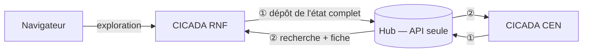

# 21. Exploration fédérée et hub

CICADA tourne en **plusieurs instances** (RNF, un CEN, une DREAL…), chacune avec sa base. Le **hub** agrège leurs index pour que l'exploration des données soit transverse.

> Détail technique complet : section « Exploration fédérée » du `CLAUDE.md`, [MULTI_INSTANCE_LOCAL.md](../MULTI_INSTANCE_LOCAL.md), [hub/README.md](../../hub/README.md).
> Mise en production : [administration › Hub](../../documentation/docs/administration/hub.md).

## Le principe

- **L'instance va vers le hub**, jamais l'inverse : une instance derrière un pare-feu peut publier.
- **Le navigateur ne parle jamais au hub** : le backend de l'instance relaie la recherche.
- Rien n'identifie un objet d'une instance à l'autre : un plan se désigne par `instance:slug`, chaque réponse dit d'où elle vient (`instance_id`, `instance_libelle`).

## Ce qui sort, ce qui ne sort jamais

| Publié | Jamais publié |
|--------|---------------|
| Structure des plans **validés** : enjeux, facteurs, pressions, objectifs, indicateurs, actions, suivis et protocoles | Budget, financement, RH (postes, temps) |
| Adresse des documents (servis par l'instance d'origine) | Mesures et réalisations |
| | Auteurs, dates, brouillons |

La liste est verrouillée par `TestFichePubliqueCloisonnement` et par le test « canari » (`tests/integrite/test_canari.py`).

## Consentement

Publier est un **engagement de la structure** : `SiteConfiguration.federation_partage`, faux par défaut, réglé par un super admin.

- Coché : publication chaque nuit, exploration **nationale**.
- Décoché : plans retirés du hub immédiatement, exploration **locale** seulement (qui ne partage plus n'a plus accès).

## Publication

Trois temps : ouvrir un lot → déposer les plans par pages → basculer. À la bascule, le hub purge les plans de l'instance absents du lot. En cas d'échec, le lot est abandonné, jamais basculé à moitié. Tâche Celery `publier_vers_le_hub`, chaque nuit à une heure propre à l'instance (#701).

## Réglages

`CICADA_INSTANCE_ID` (obligatoire), `CICADA_PUBLIC_URL`, `CICADA_HUB_URL` et les jetons, `CICADA_EXPLORATION_SOURCE` (`local` / `hub`). L'URL et les jetons se saisissent aussi dans *Administration › Paramètres › Raccordement manuel* (#695).

## Tester

`scripts/federation.sh up` lance deux instances et le hub côte à côte ; `scripts/federation.sh test --bench` lance les tests de contrat, de scénario et de parité entre les deux implémentations de `filters.py`.
