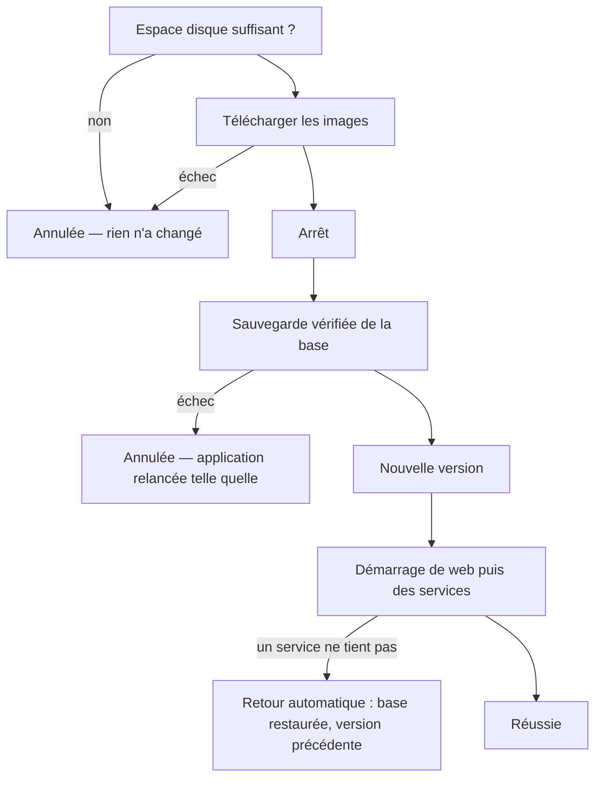

# 22. Mise à jour sûre d'une instance

Une instance se met à jour **uniquement par le bouton « Mettre à jour »** (ou `apt install`). Aucune commande manuelle ni SQL après le déploiement : toute reprise de données passe par une migration ou par un rechargement au démarrage.

> Exploitation : [administration › Installation, §§ 6 et 7](../../documentation/docs/administration/installation.md), [releases](../../documentation/docs/administration/releases.md).

## Le déroulé (#796)

- La **sauvegarde** vise la base que l'application utilise vraiment (Docker ou PostgreSQL de l'hôte), par `cicada-db` (sans Django).
- La **restauration** est tout ou rien : une transaction, nombre de lignes de chaque table contrôlé avant validation.
- Une mise à jour **interrompue** (serveur redémarré) reprend au lancement suivant (`cicada-reprise.service`).

Code : `packaging/debian/usr/share/cicada/maintenance/cicada_maintenance.py`, lancé par le `postinst`.

## Sans l'application

| Commande | Rôle |
|----------|------|
| `cicada-update status / retry / rollback / resume` | État, nouvel essai, retour arrière, reprise |
| `cicada-backup` (`--liste`, `--verifier`) | Sauvegarde quotidienne, liste, vérification |
| `cicada-restore NOM [--avec-sa-version]` | Restauration ; avec #800, retour à une version plus ancienne avec sa base |

## Ce que voit l'administrateur

*Administration › Mise à jour* affiche le résultat de la dernière mise à jour (réussie, annulée, retour fait, échec) et la date de la dernière sauvegarde (`update_result.json`, `backups.json`).

## Côté développeur

- Une donnée à réparer **une fois** → **migration de données** (`RunPython`, réversible ou `noop` au retour).
- Un contenu **livré avec le code** (référentiel, fiche) → rechargement **idempotent au démarrage** (`docker/entrypoint.sh`).
- Une commande `manage.py` peut exister pour **simuler**, jamais comme seul moyen d'appliquer.

Tests : `packaging/tests/test_maintenance.py` (un test par cas d'échec), `backend/tests/apps/system/test_cicada_db.py`.
