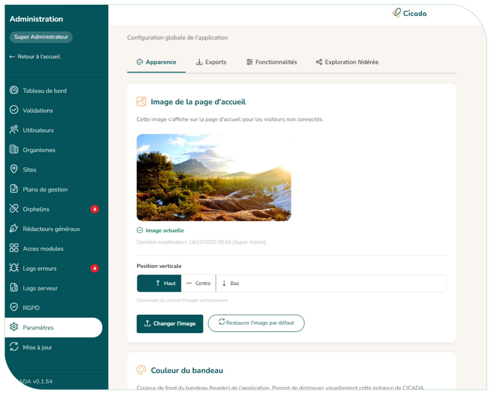

# 6.7. Paramètres de l'instance et mise à jour

Paramètres :

La page s'ouvre depuis Administration > Paramètres, ou directement par « Paramètres » dans votre menu utilisateur (en haut à droite).

- Personnaliser l'image d'accueil de l'application et sa position (haut, centre, bas) ;
- Choisir la couleur du bandeau (couleurs proposées ou personnalisée, avec aperçu) et ajouter le logo de la structure, affiché en haut à gauche ;
- Choisir la couleur des exports Excel et Word (les couleurs des scores ne changent pas) ;
- Afficher le champ « ID Doc'Gestion FCEN » dans les plans (instance de la FCEN), mesure d'audience et raccordement manuel au hub ;
- **Confier l'inscription à une plateforme externe** (onglet « Fonctionnalités ») : si votre structure gère les comptes ailleurs (annuaire, portail…), indiquez son adresse. Les boutons « Créer un compte » de l'accueil et de la page de connexion l'ouvrent alors dans un nouvel onglet, et le formulaire de demande de compte de CICADA est fermé. Laisser le champ vide pour garder l'inscription dans CICADA ;
- **Ouvrir l'API publique des métadonnées des plans** : permet à une application tierce de gestion documentaire de lire les métadonnées des plans (jamais leur contenu, leur budget ni les brouillons) ;
- **Partager les plans avec l'exploration nationale** : voir ci-dessous.

Mise à jour :

Consulter la version installée et la dernière version disponible, et déclencher une mise à jour.

**Le partage avec l'exploration nationale est un engagement à l'échelle de l'instance**. Lorsque la case est cochée :

- Les plans validés de l'instance sont publiés chaque nuit vers l'exploration nationale : enjeux, facteurs, pressions, objectifs, indicateurs, actions avec leur période, suivis et protocoles ;
- Ne sont pas partagés pour le moment : budget et financements, ressources humaines, mesures et réalisations. Si les besoins en bancarisation évoluent, les administrateurs d'instance et d'organisme seront interrogés afin d'autoriser ou non le partage d'autres données ;
- En contrepartie, les utilisateurs de l'instance explorent les plans de toutes les structures participantes.

Lorsque la case est décochée, l'exploration porte uniquement sur les plans de l'instance. Décocher la case retire immédiatement vos plans de l'exploration nationale (une confirmation est demandée). Vos utilisateurs n'explorent alors plus que les plans de l'instance. Recocher republie les plans.

<figure markdown="span">
{ loading=lazy }
<figcaption>Figure 64 : Paramètres de l'instance</figcaption>
</figure>
