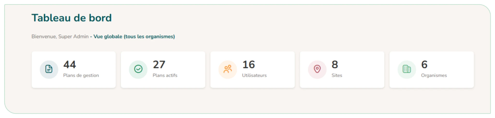

# 6.1. Le tableau de bord général d'une instance

Le tableau de bord d'une instance (à ne pas confondre avec le tableau de bord d'un plan de gestion) présente les statistiques de l'ensemble de l'application : nombre de plans (et plans actifs), d'utilisateurs, de sites et d'organismes.

<figure markdown="span">
{ loading=lazy }
<figcaption>Figure 62 : Tableau de bord général de l'administrateur d'une instance</figcaption>
</figure>
