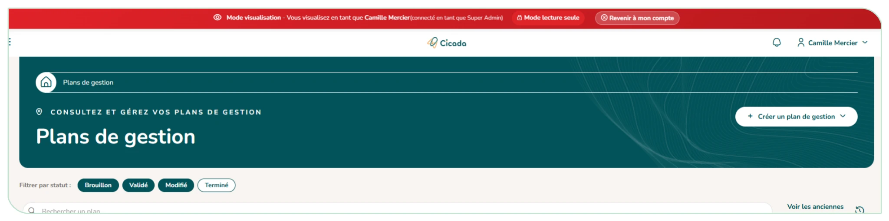

# 6.2. Gérer tous les utilisateurs et l'impersonation

Vous **gérez les utilisateurs de tous les organismes** : assigner un organisme, activer ou désactiver un compte (un motif est demandé à la désactivation).

**Promouvoir ou rétrograder un administrateur d'organisme** : en tant que super administrateur, le changement prend effet immédiatement, sans demande de validation (la justification est facultative).

Vous disposez en plus du **mode visualisation** (« impersonation ») (icône œil « Voir en tant que cet utilisateur ») : vous pouvez **naviguer dans l'application en tant qu'un autre utilisateur** pour voir exactement ce qu'il voit, en lecture seule. Un bandeau rappelle en permanence que vous êtes en mode visualisation et propose de revenir à votre compte.

<figure markdown="span">
{ loading=lazy }
<figcaption>Figure 63 : Mode de visualisation impersonation</figcaption>
</figure>
