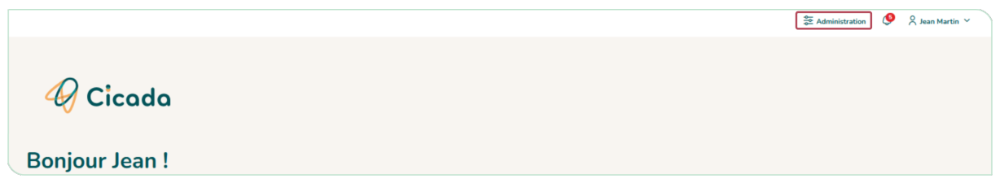
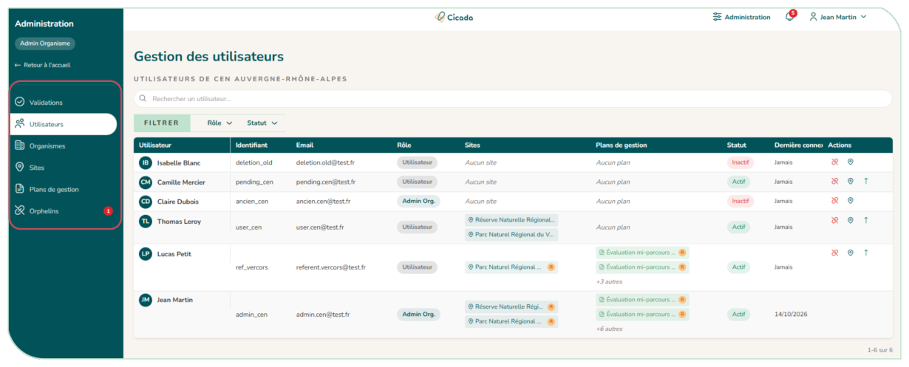

# 5.1. Accéder à l'espace administration

Un accès « **Administration** » apparaît dans l'en-tête (et dans le menu latéral). Il ouvre, dans un nouvel onglet, les pages réservées aux administrateurs : validations, utilisateurs, organismes, sites, plans de gestion, orphelins.

<figure markdown="span">
{ loading=lazy }
<figcaption>Figure 57 : Accès espace administration</figcaption>
</figure>

<figure markdown="span">
{ loading=lazy }
<figcaption>Figure 58 : Espace administration</figcaption>
</figure>
