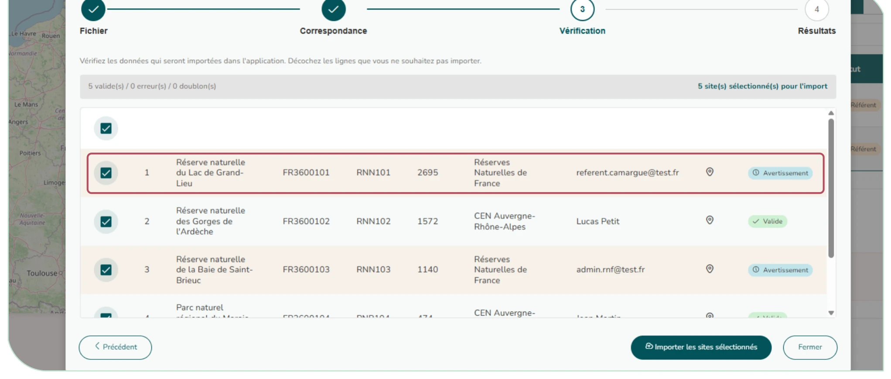

# 5.4. Importer des sites en masse

Depuis le module Mes sites, le bouton « Import en masse de sites » ouvre un assistant en quatre étapes :

1. **Fichier :** déposer un fichier de sites (GeoJSON ou CSV, 10 Mo au maximum ; seul le GeoJSON contient les contours) ;
2. **Correspondance :** associer les colonnes du fichier aux champs de CICADA ;
3. **Vérification :** prévisualiser les sites, repérer les erreurs et les doublons INPN ;
4. **Résultats :** lancer l'import et consulter le bilan (créés / ignorés).

Deux colonnes facultatives évitent de rattacher tout un import à une seule structure : Organisme gestionnaire (nom ou identifiant de l'organisme) et Référent (e-mail ou identifiant de l'utilisateur). Chaque site est alors rattaché à sa propre structure et à ses propres référents. Plusieurs valeurs se séparent par un point-virgule (« CEN A ; CEN B ») ; le premier organisme cité devient le gestionnaire principal. Une valeur introuvable n'empêche pas l'import : elle est signalée en avertissement à l'étape de vérification, et la ligne est rattachée à votre organisme (et à vous comme référent). Un administrateur d'organisme ne peut rattacher que les utilisateurs de son propre organisme.

Un fichier produit par l'export GeoJSON des sites ([§ 3.4](../utilisateur/notice/consulter-sites.md)), y compris depuis une autre instance CICADA, se réimporte sans retouche : ses colonnes sont reconnues d'office à l'étape de correspondance, le type de site y figure par son code (« RNN ») et les organismes gestionnaires par leur nom, gestionnaire principal en tête. Un site dont le code INPN existe déjà est signalé comme doublon : rattachez alors le plan au site existant plutôt que de le recréer.

<figure markdown="span">
{ loading=lazy }
<figcaption>Figure 59 : Import en masse de plan de gestion - étape de vérification</figcaption>
</figure>
