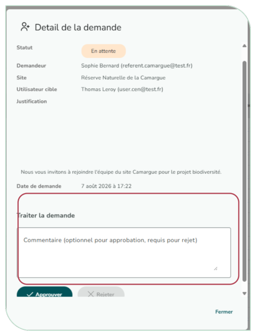
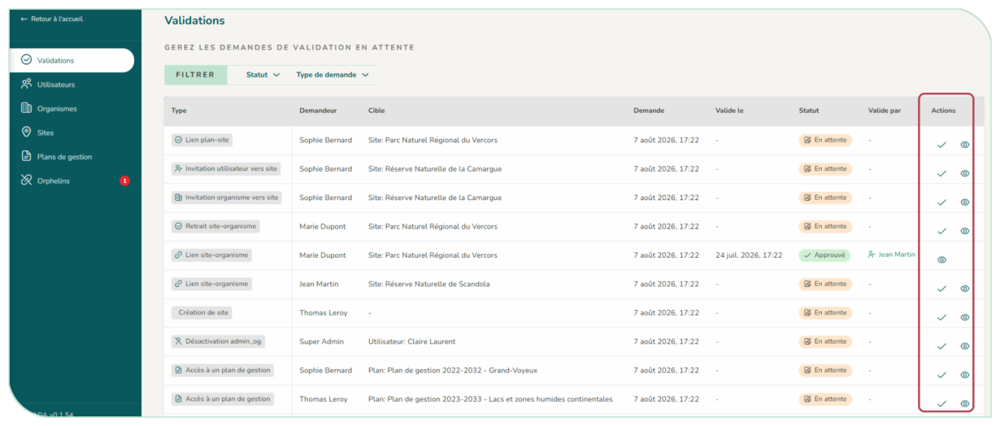

# 5.6. Traiter les validations

La page « Validations » rassemble les demandes à traiter sur votre périmètre (inscriptions, accès à un site ou un plan, créations de site, rattachements, créations d'organisme…). Vous pouvez approuver ou rejeter chaque demande, soit rapidement depuis la liste (hormis pour rejeter), soit via une fenêtre de détail qui affiche le contexte complet (et, le cas échéant, le choix entre rôle « référent » et « utilisateur »). Un commentaire est obligatoire pour un rejet.

Pour une inscription, la fenêtre indique si l'organisme a déjà un administrateur : « Nouvel organisme », « Cet organisme n'a aucun administrateur » (pensez alors à promouvoir le compte après l'avoir accepté) ou « Cet organisme a déjà N administrateur(s) ». Des avertissements rappellent aussi l'ordre de traitement (par exemple, valider le lien organisme–site avant l'accès au site).

<figure markdown="span" class="figure--small">
{ loading=lazy }
<figcaption>Figure 60 : Fenêtre de détail d'une validation</figcaption>
</figure>

<figure markdown="span">
{ loading=lazy }
<figcaption>Figure 61 : Page Validations</figcaption>
</figure>
