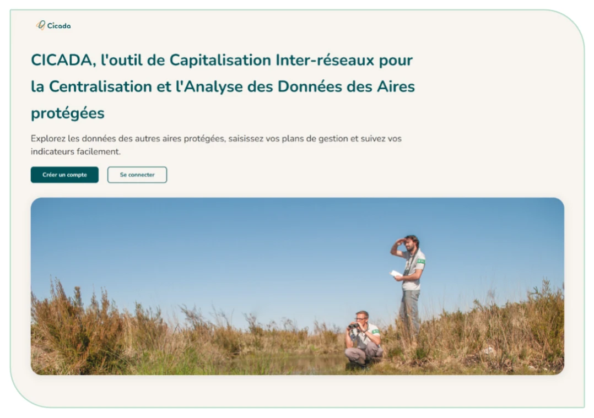

# Documentation CICADA

## Contexte et consignes de lecture

CICADA est un outil numérique **open source** destiné à accompagner la gestion des aires protégées, notamment par la **saisie et le suivi des plans de gestion** selon la méthodologie **CT88**.

<figure markdown="span" class="figure--medium">
{ loading=lazy }
<figcaption>Figure 1 : Page d'accueil de CICADA - instance de RNF</figcaption>
</figure>

Développé par **Réserves Naturelles de France (RNF)** et la **Fédération des Conservatoires d'espaces naturels (FCEN)**, en partenariat avec la Ligue pour la protection des oiseaux (LPO), PatriNat et l'Office français de la biodiversité (OFB) dans le cadre du programme européen **LIFE Biodiv'France**, CICADA vise à structurer le travail des gestionnaires tout en facilitant la remontée et la valorisation des données à l'échelle des réseaux.

À ce jour, l'outil permet la saisie, le suivi et l'exploration des plans de gestion. Le module « Zonages réglementaires » sera développé en 2027. D'autres modules pourront aussi voir le jour ultérieurement, au gré des besoins et moyens disponibles.

Cette documentation rassemble trois ensembles. La **barre de recherche** en haut de page permet de retrouver directement une fonctionnalité, quel que soit l'ensemble où elle est décrite.

<a href="utilisateur/" class="tile--green">
<strong>Guide utilisateur</strong>
La notice d'utilisation de CICADA : connexion, sites, plans de gestion, saisie, suivi, exploration des données et administration. Quatre notices selon votre profil (ci-dessous).
</a>

<a href="administration/" class="tile--yellow">
<strong>Administration technique</strong>
Installer, mettre à jour et exploiter une instance CICADA : paquet Debian, Docker, serveur Apache, hub d'exploration fédérée.
</a>

<a href="api/" class="tile--salmon">
<strong>API</strong>
Authentification, permissions, API publique des métadonnées des plans et référence complète des endpoints REST.
</a>

La notice d'utilisation est également disponible au format imprimable :

[:material-file-pdf-box: Télécharger la notice (PDF)](assets/notice-utilisation-cicada.pdf){ .notice-pdf download="Notice d'utilisation CICADA.pdf" }

Version V4, octobre 2026 — 38 pages, 15 Mo. Le site, lui, suit les évolutions de l'outil : en cas d'écart, c'est lui qui fait foi.

## Les différents rôles et profils

Le guide utilisateur rassemble quatre notices. Chacune s'adresse à un profil d'utilisateur différent. Les profils sont cumulatifs : un administrateur peut faire tout ce que fait un utilisateur simple, en plus des fonctions propres à son rôle.

| Profil | À qui s'adresse la notice | Où lire |
|--------|---------------------------|---------|
| **Utilisateur** | Toute personne disposant d'un compte CICADA | [Notice Utilisateur](utilisateur/notice/index.md) |
| **Référent de plan de gestion** | Personne(s) chargée(s) de saisir et suivre un plan (référent(s) du plan) | [Notice Référent d'un plan de gestion](referent/index.md) |
| **Administrateur d'organisme** | Responsable d'un organisme gestionnaire (CEN, RNF, Parc…) | [Notice Administrateur d'organisme](admin-organisme/index.md) |
| **Administrateur d'une instance** | Super administrateur : pilote l'ensemble de l'outil sur son instance déployée | [Notice Administrateur d'une instance](admin-instance/index.md) et [Administration technique](administration/index.md) |

!!! tip "Il existe deux profils intermédiaires :"

    - **Le rédacteur général :** il peut consulter et modifier tous les plans de gestion et tous les sites de son instance. Il utilise donc les notices [Utilisateur](utilisateur/notice/index.md), [Référent](referent/index.md) et [Administrateur d'organisme](admin-organisme/index.md). Ce rôle n'est attribuable que par le super administrateur.
    - **Le rédacteur externe :** il peut saisir et modifier un plan de gestion sur lequel il a des droits (mais n'a pas accès aux suivis). Ce profil permet à des personnes externes à l'organisme gestionnaire, de rédiger un plan (ex : prestataire). Ce rôle est attribuable par l'administrateur de l'instance ou par un référent du plan concerné.

**Les fonctions de base** (se connecter, gérer son profil, recevoir des notifications, consulter des sites et plans, demander un accès) **ne sont décrites qu'une seule fois, dans la [Notice Utilisateur](utilisateur/notice/index.md)**. Les notices suivantes y renvoient et ne détaillent que ce qui est propre à chaque rôle d'administration.

Les développeurs et les intégrateurs (application documentaire tierce, connexion GeoNature, scripts) trouveront leur compte dans la partie [API](api/index.md) ; l'installation et l'exploitation d'une instance sont décrites dans l'[Administration technique](administration/index.md).
