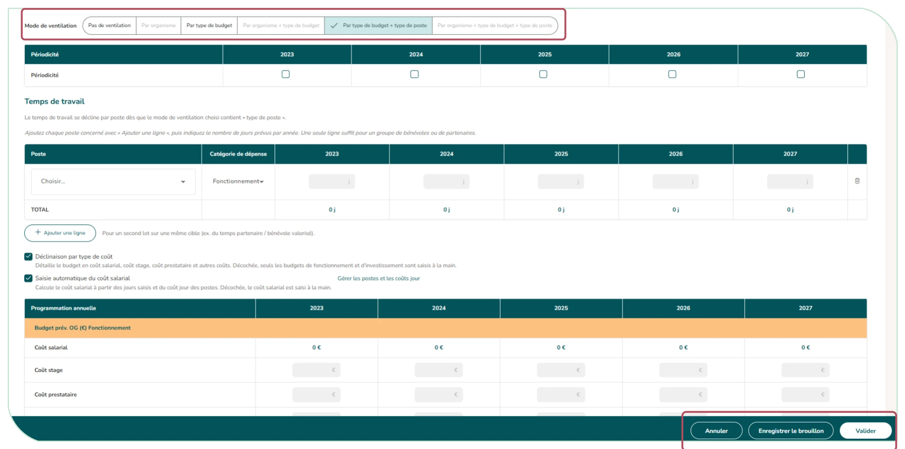
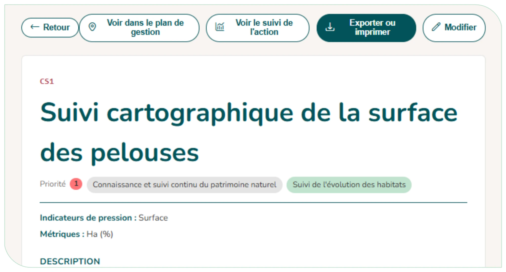

# 4.8. Les actions de gestion

## 4.8.1. La saisie d'une action de gestion

Une action se saisit via son formulaire dédié (bouton « Ajouter une action » ou de modification). Vous y renseignez notamment :

- Le type d'action (obligatoire) choisi dans le référentiel GestRef ; et facultativement la catégorie d'action CT88, si celle-ci est différente de celle du référentiel GestRef ;
- Le code de l'action, calculé automatiquement (ex. CS1) et affiché en direct ; le champ « Numéro fixé » permet d'imposer son numéro ;
- L'intitulé (s'il reste vide, il est rempli automatiquement avec le type d'action GestRef à l'enregistrement), les métriques associées et la priorité ;
- Pour une action d'inventaire ou de suivi : les détails de l'inventaire ou du suivi (objectif, cible, taxons ou habitats rattachés), les protocoles et la bancarisation de la donnée ;
- La programmation : sites concernés, années, temps de travail, budget et mois prévus ; opérateurs, partenaires et financeurs ;
- La localisation (emprise spatiale) — une case permet de reprendre l'emprise du ou des sites ; elle reste cochée à la réouverture de l'action, et la décocher retire les contours des sites pour revenir à l'emprise dessinée ou importée auparavant (carte vide s'il n'y en avait pas). Pour dessiner l'emprise, cliquez sur « Dessiner / importer », puis sur **« Tracer un contour »** en haut à gauche de la carte ; pour charger un fichier (GeoJSON ou shapefile en .zip), sur **« Importer »** en haut à droite ;
- Les indicateurs de réponse : un intitulé (obligatoire), puis soit une métrique simple avec une valeur cible, soit une grille de scoring à 5 niveaux (case « Utiliser une grille de scoring »), construite comme celle des métriques des indicateurs état et pression ([§ 4.7](indicateurs-metriques.md)).

Un suivi peut mobiliser plusieurs protocoles : la section « Protocoles » en présente un bloc chacun, le bouton « Ajouter un protocole » en ajoute un et l'icône corbeille retire un bloc (il en reste toujours un). Au-delà de trois protocoles, une mention rappelle que la fiche devient difficile à lire. Pour chaque protocole, il est demandé de préciser s'il est standardisé ou non :

- oui : recherchez-le dans le catalogue des protocoles standardisés (Une distinction et les 5 protocoles MhéO), consultez sa fiche, puis précisez si vous le respectez strictement (sinon, pourquoi et avec quelles différences).
- non : décrivez votre protocole (nom, ETP par cycle, description, objectif, période d'échantillonnage).

Si l'action est rattachée à un inventaire ou suivi déjà saisi dans le module Inventaires, ses protocoles s'affichent en lecture seule : ils se modifient depuis la fiche du suivi.

La fréquence (ex. 2 fois par an), intégrée pour les actions de suivis, peut être appliquée automatiquement aux années et aux mois avec le bouton « Appliquer aux années ».

**Le mode de ventilation du budget** : Il définit le niveau de détail de la programmation :

| Mode de ventilation | Ce que vous saisissez |
|---------------------|-----------------------|
| **Pas de ventilation** | Un budget et un temps de travail globaux par année |
| **Par organisme** | Le budget et le temps réparti entre les organismes gestionnaires |
| **Par type de budget** | Un distinction du budget par type (fonctionnement / investissement) |
| **Par organisme + type de budget** | Les deux combinés |
| **Par type de budget + type de poste** | Fonctionnement / investissement, et temps de travail par poste |
| **Par organisme + type de budget + type de poste** | Le niveau le plus détaillé |

<em style="color:#025359;font-size:0.78rem">Figure 45 : Modes de ventilation budgétaire</em>

Deux cases complètent le mode de ventilation :

- « **Déclinaison par type de coût** » (tous les modes) : détaille le budget en coût salarial, coût stage, coût prestataire et autres coûts, et le **temps de travail poste par poste**. Décochée, seuls les totaux sont saisis : fonctionnement et investissement quand le mode inclut le type de budget, le budget total sinon ;
- « **Saisie automatique du coût salarial** » (dès que la déclinaison par type de coût est cochée) : calcule le coût salarial à partir des jours saisis et du coût jour des postes ([§ 4.3.1](parametrage.md#431-les-postes-ressources-humaines)). Décochée, le coût salarial se saisit à la main.

**Sans ventilation par type de budget** (« Pas de ventilation », « Par organisme »), rien ne distingue le fonctionnement de l'investissement : ni le budget, ni le temps de travail (pas de catégorie de dépense), dans la saisie de l'action comme dans son suivi, sa fiche et ses exports.

**La saisie du budget et du temps de travail** se fait « **Par année** » (par défaut) ou « **Globale sur la période** ». En saisie globale, les années programmées restent cochées une à une (périodicité, mois), mais le budget et le temps de travail n'ont plus qu'une colonne « Période », pour toute la durée de l'action : c'est utile quand le budget d'une action est connu pour l'ensemble de sa période sans pouvoir être réparti par année. Les sous-modes de ventilation restent les mêmes. Passer d'une saisie à l'autre demande une confirmation, car une partie de la saisie est perdue :

- par année → globale : les montants et les jours des années sont **additionnés** dans la colonne « Période » ; la répartition par année disparaît ;
- globale → par année : la colonne « Période » est **vidée** ; les montants sont à ressaisir année par année.

Le temps de travail distingue le temps agent (gestionnaire) et le temps partenaire / bénévole (valorisé), sauf en « aucune ventilation » sans déclinaison par type de coût : le temps s'y réduit à un seul « Temps de travail total » par année, sans ligne supplémentaire. Quand le mode inclut le type de budget, chaque ligne porte une catégorie de dépense (fonctionnement, investissement, bénévolat partenariat) ; sinon, le temps d'un poste bénévole ou partenaire est valorisé d'office. Une nouvelle action reprend le paramétrage de ventilation de la dernière action saisie dans le plan.

Le formulaire propose deux boutons :

- **Enregistrer le brouillon :** sauvegarde votre saisie sans tout valider et vous laisse sur le formulaire (idéal pour saisir progressivement) ; l'action apparaît alors comme « Brouillon » dans les listes ;
- **Valider** : contrôle que tous les champs requis sont remplis, puis enregistre l'action.

!!! tip "Une action ne correspond à aucun type proposé :"

    Sélectionner un niveau supérieur auquel celle-ci peut se rattacher, à défaut d'être précisé à un niveau fin. Si aucune catégorie (même le niveau le plus large) ne permet d'intégrer votre action, choisissez « autre action de gestion ».

<figure markdown="span">
{ loading=lazy }
<figcaption>Figure 46 : Formulaire de saisie d'une action de gestion</figcaption>
</figure>

## 4.8.2. La fiche action

Chaque action peut être visualisée sous le format d'une fiche de consultation qui rassemble toutes ses informations de manière plus visuelle : indicateurs et métriques liés, description, protocole et objectifs, temporalité, acteurs, programmation (budget, détail des coûts, temps de travail, financements), indicateurs de réponse, emprise spatiale et réalisation.

Depuis la fiche, vous pouvez :

- « **Voir dans le plan de gestion** » : ouvrir l'enjeu à l'endroit de l'action ;
- « **Voir le suivi de l'action** » ;
- « **Exporter ou imprimer** » : au format Impression / PDF (en choisissant les sections à inclure) ou Excel ;
- « **Modifier l'action** » (plan en brouillon).

<figure markdown="span">
{ loading=lazy }
<figcaption>Figure 47 : Fiche action</figcaption>
</figure>
