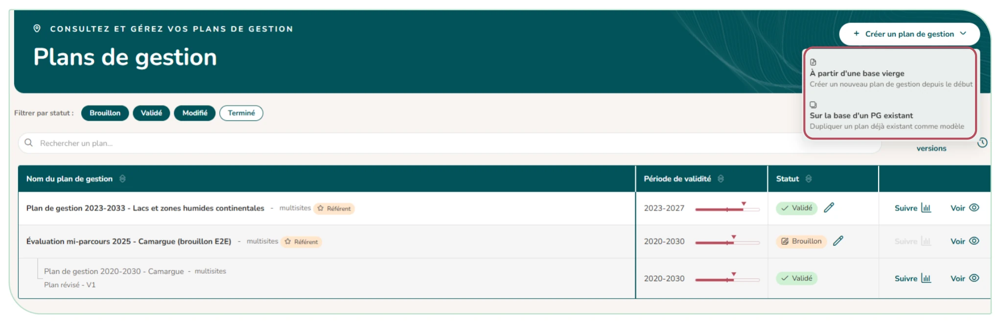
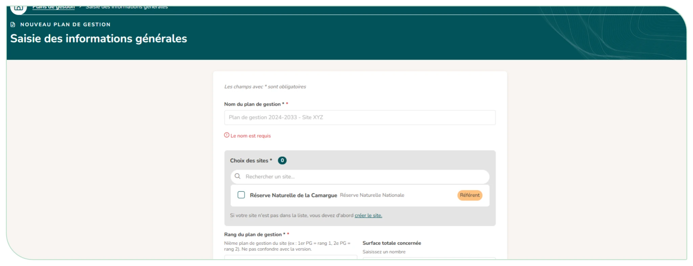
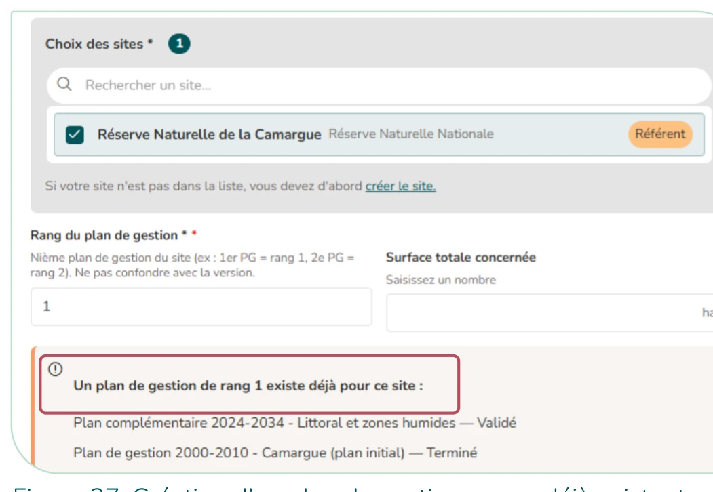
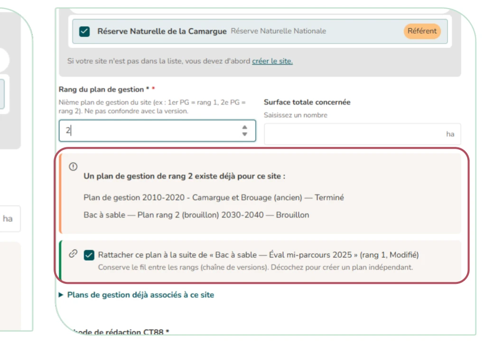

# 4.1. Créer un nouveau plan de gestion

Ouvrez le module « **Mes plans de gestion** » depuis la page d'accueil de l'outil et cliquez sur « **Créer un plan de gestion** ».

Deux options de création sont proposées (Figure 25) :

- « **À partir d'une base vierge** » (créer un plan vide) ;
- « Sur la base d'un PG existant » (dupliquer un plan comme modèle) : vous choisissez ce qui est repris (sites associés, référents, fichiers joints, enjeux et FCR, sous-éléments).

<figure markdown="span">
{ loading=lazy }
<figcaption>Figure 25 : Volet de création d'un nouveau plan de gestion sur la page d'accueil du module « Mes plans de gestion »</figcaption>
</figure>

**Le formulaire « Saisie des informations générales » vous demande :**

- Le nom du plan, ses années de début et de fin, son rang (n-ième plan de gestion du site : 1er PG = rang 1… à ne pas confondre avec la version) et s'il a été rédigé selon la méthode CT88 ;
- Des informations facultatives : surface, date de l'avis du CSRPN, type et organisme rédacteur principal (un organisme absent peut être créé), noms des rédacteurs, relecteurs et autres contributeurs ;
- **Les sites** couverts par le plan (vous pouvez en sélectionner plusieurs). Si votre site n'est pas dans la liste, il faut d'abord le créer ([§ 3.5, « Rejoindre ou créer un nouveau site »](../utilisateur/notice/rejoindre-creer-site.md)).

**Le fil entre les rangs :** Lorsque les sites choisis ont déjà des plans de gestion, un encadré s'affiche :

- Un avertissement (non bloquant) si un plan du même rang existe déjà sur le site ;
- La case « Rattacher ce plan à la suite de … », cochée par défaut : elle relie le nouveau plan au plan du rang précédent, pour conserver l'historique du site. Décochez-la pour créer un plan indépendant ;
- Le volet « Plans de gestion déjà associés à ce site », qui les liste par rang.

À l'enregistrement, le plan est créé en brouillon : il est alors entièrement modifiable. Vous en devenez automatiquement référent (sauf si vous êtes administrateur de l'instance ou rédacteur général : vous avez déjà tous les droits sur le plan). Tant que le plan est en brouillon, le bouton « Modifier le plan de gestion » permet de revenir sur ces informations générales (y compris le lien avec le plan du rang précédent) ; la fenêtre rappelle la place du plan dans sa chaîne de versions (rang, version, plan parent).

**Organisme rédacteur d'un plan confié à un rédacteur externe :** quand un rédacteur externe (bureau d'étude…) est rattaché au plan, son organisme s'ajoute sous « Autres organismes rédacteurs ». L'organisme rédacteur principal ne change pas : c'est celui que vous avez choisi ou, à défaut, l'organisme gestionnaire du site. Dans « Modifier le plan de gestion », vous pouvez changer l'organisme principal et retirer un autre organisme. Retirer l'organisme du rédacteur externe ne lui retire pas son accès au plan.

<figure markdown="span">
{ loading=lazy }
<figcaption>Figure 26 : Formulaire de création d'un plan de gestion – saisie des informations générales</figcaption>
</figure>

<figure markdown="span">
{ loading=lazy }
<figcaption>Figure 27 : Création d'un plan de gestion – rang déjà existant</figcaption>
</figure>
<figure markdown="span">
{ loading=lazy }
<figcaption>Figure 28 : Création d'un plan de gestion – chaîne de version</figcaption>
</figure>

