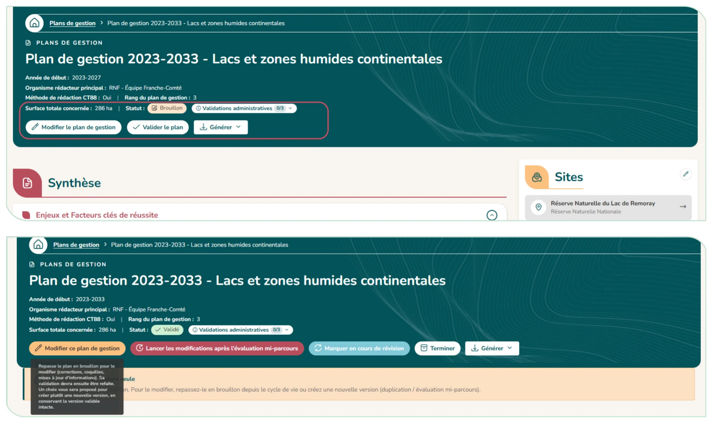
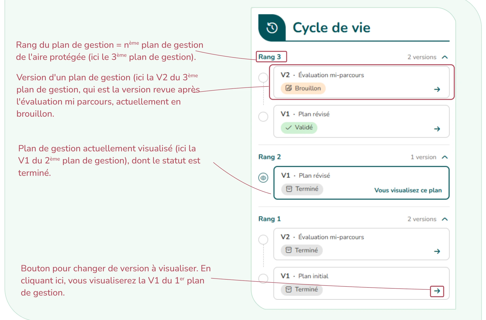

# 4.4. Le cycle de vie d'un plan de gestion

Un plan passe par une série de statuts. Le statut détermine si le plan est modifiable et s'il est actif.

| Statut | Modifiable ? | Signification |
|--------|--------------|---------------|
| **Brouillon** | Oui | Plan en cours de saisie. Seul statut où le contenu peut être modifié. Le suivi du plan de gestion n'est pas modifiable |
| **Validé** | Non | Plan officiel en vigueur. Le suivi devient possible. |
| **Modifié** | Non | Plan validé puis modifié au moins une fois au sein du même rang. |
| **Terminé** | Non | Plan clôturé : consultable mais plus actif, suivi inaccessible. |

<em style="color:#025359;font-size:0.78rem">Figure 36 : Les différents statuts des plans de gestion</em>

Des étiquettes peuvent s'ajouter au statut :

- **Évaluation à mi-parcours** (une version porte cette évaluation, unique par chaîne)
- **Étendu / Prolongé** (+1 ou +2 ans) afin de permettre la transition avec le plan de gestion suivant, en cours de rédaction ;
- **En cours de révision** (un nouveau plan se prépare en parallèle) ;

**Lorsqu'un plan n'est pas en brouillon**, un bandeau de verrouillage s'affiche en haut de la page : **le contenu ne peut plus être modifié**. Pour le retravailler, il faut le repasser en brouillon ou créer une nouvelle version.

Selon le statut et vos droits, vous disposez d'**actions de cycle de vie** :

- **Valider le plan** (depuis un brouillon). Si un autre plan précédant dans la chaîne est encore actif, il est proposé de le terminer ;
- **Modifier ce plan de gestion** (sur un plan validé) : une fenêtre vous recommande de créer une nouvelle version (le contenu est copié dans un nouveau brouillon, la version validée reste intacte) plutôt que de remettre cette version en brouillon (qui provoque une annulation de la validation et le suivi n'est plus accessible) ;
- **Étendre la durée du plan** (+1 ou +2 ans) : CICADA crée un brouillon de version étendue, à compléter (actions sur les années ajoutées) puis à valider. Vous pouvez annuler l'extension ;
- **Marquer en cours de révision** : Vous pouvez créer le brouillon du plan du rang suivant, le lier à un brouillon déjà existant, ou marquer le plan sans lien. Vous pouvez annuler la révision
- **Évaluation mi-parcours** : crée (ou lie) un nouveau brouillon, copié sur le plan précédent, afin de permettre d'intégrer les modifications issues de l'évaluation. Une seule version évaluation mi-parcours est possible par plan ;
- **Terminer / Réactiver le plan.**

Les validations administratives (avis du CSRPN, validation par le comité consultatif, arrêté préfectoral pour les réserves naturelles nationales) ne concernent que les réserves naturelles. Pour ces plans, un badge « Validations administratives » s'affiche à côté du statut : cliquez dessus pour enregistrer, modifier ou effacer chaque validation (date, et numéro pour l'arrêté). Ces validations ne bloquent pas le changement de statut du plan.

Une chronologie des versions (encadré « Cycle de vie ») retrace l'historique du plan et de ses révisions, regroupées par rang ; un clic sur une version l'ouvre.

<figure markdown="span">
{ loading=lazy }
<figcaption>Figure 37 : Boutons action du cycle de vie</figcaption>
</figure>

!!! tip "Qui peut agir sur le cycle de vie ?"

    Les référents du plan, les administrateurs d'organisme, le rédacteur général et le super administrateur. Les autres utilisateurs consultent sans pouvoir changer le statut.

<figure markdown="span">
{ loading=lazy }
<figcaption>Figure 38 : Section du cycle de vie d'un plan de gestion</figcaption>
</figure>
