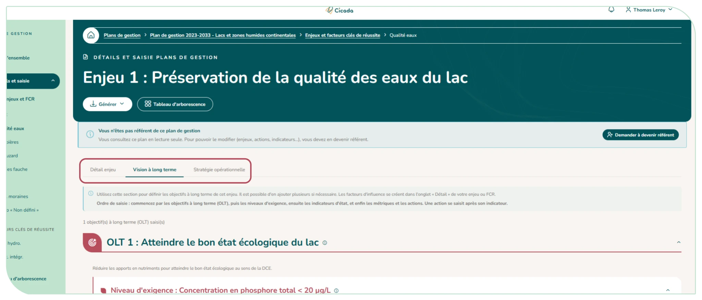
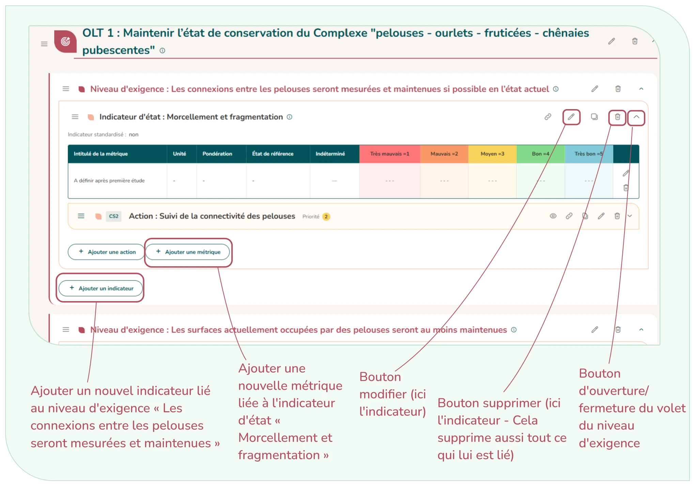

# 4.5. Les enjeux et leur contenu

Le cœur de la saisie se fait dans le menu « Détails et saisie ». Pour chaque enjeu (ou facteur clé de réussite), vous renseignez son intitulé, un intitulé court, sa priorité (1, 2, 3 ou « Non définie »), sa catégorie et des éléments descriptifs optionnels (état de l'enjeu, détails).

Pour un **enjeu de conservation du patrimoine naturel**, vous indiquez à quoi il est lié : habitats, espèces, patrimoine géologique, fonctionnalités des écosystèmes ou autre.

- **Habitats et espèces** : au <u>moins un élément est alors obligatoire</u>. La recherche d'espèces s'appuie sur **TaxRef** ; si votre taxon n'est pas trouvé, le lien « **Je ne trouve pas mon taxon (rechercher dans les synonymes)** » élargit la recherche aux synonymes et rattache le nom valide. La recherche d'habitats s'appuie sur **HabRef et peut être filtrée par typologie**. Une liste de codes peut aussi être importée d'un coup.
- **Patrimoine géologique** : choisissez le site dans l'inventaire du patrimoine géologique, le type de patrimoine (in situ, ex situ, documents, autre) et les objets géologiques concernés dans des listes déroulantes. Le type « Documents » permet de joindre des fichiers ou d'ajouter une référence à un document papier.

Pour un **enjeu socio-économique,** vous indiquez s'il est lié à la valeur paysagère, au patrimoine culturel, aux ressources, aux usages, etc.

**Un facteur clé de réussite (FCR)** a sa propre catégorie (connaissance, ancrage territorial, fonctionnement de l'aire protégée, surveillance, autre).

**Numéroter à la main :** Les enjeux, FCR, objectifs à long terme et objectifs opérationnels sont numérotés automatiquement. Le champ « Numéro fixé (facultatif) » permet d'imposer un numéro (pour reprendre la numérotation de votre plan d'origine) : il ne bougera plus et les autres éléments sauteront ce numéro.

Une fois un enjeu ou un FCR créé, son nom court apparaît dans la barre latérale, cliquez dessus. Chacun se décline alors selon trois onglets :

- **Détail enjeu** : les facteurs d'influence → les pressions qui pèsent sur l'enjeu (le type de pression peut être choisi dans le référentiel PressRef) ;
- **Vision à long terme** : la hiérarchie Objectif long terme → Niveau d'exigence → Indicateur d'état → Métrique, puis les actions ;
- **Stratégie opérationnelle** : les objectifs opérationnels (associés à une ou plusieurs pressions), les résultats attendus, les indicateurs de pression et leurs actions.

Pour ajouter un élément à votre arborescence, il vous suffit de cliquer sur le bouton correspondant. Vous pouvez à tout moment consulter le tableau d'arborescence afin de vous retrouver dans l'architecture (barre latérale).

**Les boutons « Je n'ai pas de … » :** Lorsqu'un niveau de la hiérarchie n'existe pas dans votre plan, un bouton permet de créer un élément « Non défini » qui tient la place, sans inventer de contenu. Il est préconisé de le renseigner dès que possible. Six boutons existent :

- « Je n'ai pas de facteur d'influence » ;
- « Je n'ai pas de pression » ;
- « Je n'ai pas de niveau d'exigence » ;
- « Je n'ai pas d'indicateur d'état » ;
- « Je n'ai pas de résultat attendu » ;
- « Je n'ai pas d'indicateur de pression ».

**Réorganiser par glisser-déposer :** La grande majorité des éléments peuvent être réorganisés, ce qui impact leur numérotation automatique. Par exemples, une pression peut être déplacée vers un autre facteur, et une action vers un autre indicateur ou l'ordre de tous les enjeux/FCR peut être revu.

<figure markdown="span">
{ loading=lazy }
<figcaption>Figure 39 : Détails d'un enjeu</figcaption>
</figure>

!!! tip "L'habitat de mon enjeu n'existe pas dans HabRef"

    L'option « Je ne trouve pas mon habitat dans la liste » vous permet de saisir librement un habitat hors référentiel.

<figure markdown="span">
{ loading=lazy }
<figcaption>Figure 40 : Planche de gestion des boutons de l'arborescence</figcaption>
</figure>
