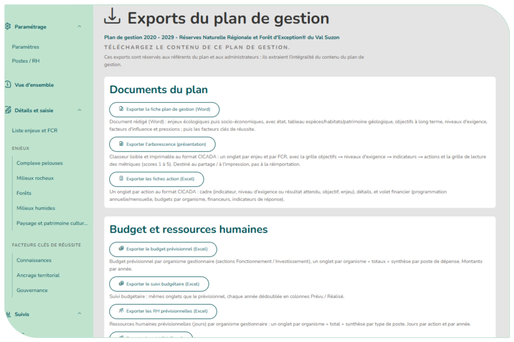

# 4.12. Les exports du plan

La rubrique « Exports » permet de télécharger le contenu du plan. Elle est réservée aux référents du plan, aux rédacteurs généraux et aux administrateurs.

| Groupe | Export |
|--------|--------|
| **Documents du plan** | Fiche plan de gestion (Word) Arborescence (Excel) Fiches action (Excel) |
| **Budget et ressources humaines** | Budget prévisionnel (Excel) Suivi budgétaire (Excel) RH prévisionnelle (Excel) Suivi RH (Excel) Fiches de suivi des actions (Excel, pour une année choisie) |
| **Données brutes** | Contenu du plan (Excel, au format du modèle d'import : réimportable dans un autre plan en brouillon) |

Les exports suivent le **paramétrage de ventilation** des actions ([§ 4.8.1](actions.md#481-la-saisie-dune-action-de-gestion)) :

- **Fiches action (Excel et Word)** : chaque fiche reprend ce que le gestionnaire a saisi pour l'action. Sans ventilation par type de budget, ni le budget ni le temps de travail ne distinguent fonctionnement et investissement ; sans ventilation par organisme, il n'y a pas de bloc par organisme ; sans déclinaison par type de coût, seuls les totaux figurent. Une action **programmée globalement sur sa période** n'a qu'une colonne « Période … » pour son budget et son temps de travail, sans colonnes d'années vides.
- **Budget et RH (prévisionnel et suivi)** : chaque dimension n'apparaît que si au moins une action du plan la saisit (la ventilation la plus détaillée l'emporte) — onglets par organisme gestionnaire, sections fonctionnement / investissement, synthèse par poste de dépense, synthèse par type de poste. Une action programmée globalement porte son prévisionnel dans une colonne « Période (global) », placée avant le total ; son réalisé reste ventilé par année. Les deux exports de **suivi** ajoutent un onglet « **Détail par action** » : pour chaque action, rattachée à son enjeu / FCR, son OLT et son OO, une ligne par poste de dépense (coût salarial, stage, prestataire, autres — distingués fonctionnement / investissement si le mode le prévoit ; à défaut, l'enveloppe saisie) pour le budget, ou par poste (temps total, organisme) pour les RH, avec prévu et réalisé de chaque année, puis une ligne « Total action ». Côté RH, le temps bénévole ou partenaire reste détaillé sur une ligne colorée, mais il n'entre pas dans le total, intitulé alors « Total action (hors bénévolat / partenariat) ». Les synthèses ne comptent elles aussi que le temps des agents. Juste avant, l'onglet « **Synthèse par action** » donne **une ligne par action** (enjeu / FCR, OLT, OO, codes, libellé) avec son total — budget fonctionnement + investissement, tous organismes confondus, ou temps de travail — prévu et réalisé de chaque année, puis le TOTAL du plan. Le « Contenu du plan » (données brutes) ne reprend pas encore cette programmation globale, ni le détail des coûts des modes « Pas de ventilation » et « Par organisme » (seul leur total y figure).

- **Fiches de suivi des actions** : choisir l'année sous le bouton ; une fiche (onglet) par action dont le suivi est saisi cette année-là, qui rappelle en tête l'indicateur d'état (ou de pression) et l'objectif de l'action, puis met en regard le **prévu** et le **réalisé** : niveau de réalisation, opérateurs et financeurs, temps de travail par poste, budget par poste de dépense, indicateurs de réponse (valeur cible / valeur saisie), **résultat de l'indicateur d'état ou de pression** (la mesure de l'année, rangée dans la colonne de son score, de « Indéterminé » à « Très bon » ; sans mesure cette année-là, la dernière mesure antérieure — N-1, sinon N-2… — précédée de son année ; « Aucune mesure » s'il n'y en a jamais eu), emprise prévue et réalisée sur une même carte, commentaires. Pour une action programmée globalement, le prévu annuel est noté « / ». La même fiche s'exporte depuis la saisie du suivi d'une action (« Exporter la fiche de suivi », pour l'année affichée).

Les tableaux, graphiques de suivi (tableau de bord, suivi des actions, bilan) et la fiche d'une action ont aussi leur propre bouton d'export ([§ 4.9.1](suivi.md#491-le-tableau-de-bord-et-le-suivi-des-indicateurs-état-et-pression), [§ 4.9.3](suivi.md#493-le-bilan-de-la-gestion), [§ 4.9.2](suivi.md#492-le-suivi-des-actions-de-gestion) et [§ 4.8.2](actions.md#482-la-fiche-action)).

<figure markdown="span">
{ loading=lazy }
<figcaption>Figure 55 : Page Exports</figcaption>
</figure>

D'autres exports seront disponibles courant 2027, notamment une trame de rapport d'activité.
