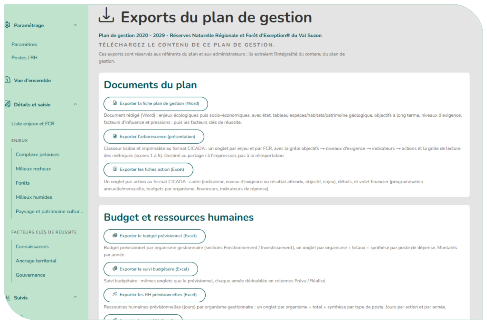

# 4.12. Les exports du plan

La rubrique « Exports » permet de télécharger le contenu du plan. Elle est réservée aux référents du plan, aux rédacteurs généraux et aux administrateurs.

| Groupe | Export |
|--------|--------|
| **Documents du plan** | Fiche plan de gestion (Word) Arborescence (Excel) Fiches action (Excel) |
| **Budget et ressources humaines** | Budget prévisionnel (Excel) Suivi budgétaire (Excel) RH prévisionnelle (Excel) Suivi RH (Excel) Fiches de suivi des actions (Excel, pour une année choisie) Planification annuelle (Excel, pour une année choisie) |
| **Données brutes** | Contenu du plan (Excel, au format du modèle d'import : réimportable dans un autre plan en brouillon) Actions (Excel, format réimportable) |

Les exports suivent le **paramétrage de ventilation** des actions ([§ 4.8.1](actions.md#481-la-saisie-dune-action-de-gestion)) :

- **Fiches action (Excel et Word)** : chaque fiche reprend ce que le gestionnaire a saisi pour l'action. Sans ventilation par type de budget, ni le budget ni le temps de travail ne distinguent fonctionnement et investissement ; sans ventilation par organisme, il n'y a pas de bloc par organisme ; sans déclinaison par type de coût, seuls les totaux figurent. Une action **programmée globalement sur sa période** n'a qu'une colonne « Période … » pour son budget et son temps de travail, sans colonnes d'années vides.
- **Budget et RH (prévisionnel et suivi)** : chaque dimension n'apparaît que si au moins une action du plan la saisit (la ventilation la plus détaillée l'emporte) — onglets par organisme gestionnaire, sections fonctionnement / investissement, synthèse par poste de dépense, synthèse par type de poste. Une action programmée globalement porte son prévisionnel dans une colonne « Période (global) », placée avant le total ; son réalisé reste ventilé par année. Les deux exports de **suivi** ajoutent un onglet « **Détail par action** » : pour chaque action, rattachée à son enjeu / FCR, son OLT et son OO, une ligne par poste de dépense (coût salarial, stage, prestataire, autres — distingués fonctionnement / investissement si le mode le prévoit ; à défaut, l'enveloppe saisie) pour le budget, ou par poste (temps total, organisme) pour les RH, avec prévu et réalisé de chaque année, puis une ligne « Total action ». Côté RH, le temps bénévole ou partenaire reste détaillé sur une ligne colorée, mais il n'entre pas dans le total, intitulé alors « Total action (hors bénévolat / partenariat) ». Les synthèses ne comptent elles aussi que le temps des agents. Juste avant, l'onglet « **Synthèse par action** » donne **une ligne par action** (enjeu / FCR, OLT, OO, codes, libellé) avec son total — budget fonctionnement + investissement, tous organismes confondus, ou temps de travail — prévu et réalisé de chaque année, puis le TOTAL du plan.
- **Suivi budgétaire et suivi RH, planification annuelle** : dans les onglets par organisme et TOTAL, chaque année a trois colonnes, **Prévu PG** (plan de gestion), **Prévu ajusté** (planification annuelle ajustée, [§ 4.9.4](suivi.md#494-lajustement-de-la-planification-annuelle) ; le plan de gestion pour une année non ajustée) et **Réalisé**.

- **Montants par financeur** :
    - fiches action (Excel et Word) : montant prévu par financeur, avec l'alerte d'écart avec le budget prévu ;
    - fiches de suivi : prévu sur l'action et réalisé de l'année ;
    - budgets prévisionnel et suivi : onglet « **Par financeur** », avec une synthèse par financeur puis le détail par action. Au suivi, il donne le réalisé de chaque année. L'onglet n'apparaît que si une action porte des montants.

- **Actions (format réimportable)** : toutes les actions du plan dans le classeur du modèle d'import des actions. Il contient la programmation complète de chaque action :
    - fiche, réglages du tableau budgétaire et programmation globale ;
    - budget et temps de travail ;
    - années et mois programmés, emprises, sites et métriques liés ;
    - postes et leurs fonctions ;
    - suivi et protocoles des actions CS.

    Il se réimporte dans un plan **sans action**, sur cette instance ou une autre, après l'arborescence (classeur « Contenu du plan ») : voir [§ 4.3.2](parametrage.md#432-importer-un-plan-depuis-un-fichier-excel). Le suivi des réalisations n'en fait pas partie.

- **Fiches de suivi des actions** : choisir l'année sous le bouton ; une fiche (onglet) par action dont le suivi est saisi cette année-là, qui rappelle en tête l'indicateur d'état (ou de pression) et l'objectif de l'action, donne le niveau de réalisation et les opérateurs et financeurs de l'année (réalisé seul), puis met en regard le **prévu** et le **réalisé** : temps de travail par poste, budget par poste de dépense, indicateurs de réponse (valeur cible / valeur saisie), **résultat de l'indicateur d'état ou de pression** (la mesure de l'année, rangée dans la colonne de son score, de « Indéterminé » à « Très bon » ; sans mesure cette année-là, la dernière mesure antérieure — N-1, sinon N-2… — précédée de son année ; « Aucune mesure » s'il n'y en a jamais eu), emprise prévue et réalisée sur une même carte, commentaires. Pour une action programmée globalement, le prévu annuel est noté « / ». Le temps de travail et le budget y ont trois colonnes : **prévu du plan de gestion**, **prévu ajusté** de l'année et **réalisé** ; la ligne « Planification ajustée » donne le statut de l'année (planifiée, non prévue, reportée en …). La même fiche s'exporte depuis la saisie du suivi d'une action (« Exporter la fiche de suivi », pour l'année affichée).

- **Planification annuelle** : choisir l'année sous le bouton (le même classeur s'exporte depuis la page « Ajustement planification annuelle », pour l'année affichée). Calqué sur le budget et les RH prévisionnels, réduit à l'année :
    - onglet **Budget** : pour chaque action, son statut de l'année (avec les reports reçus), le budget du **plan de gestion**, le budget **ajusté** et l'**écart**, et la part fonctionnement / investissement de l'ajusté si une action distingue les types de budget ; puis un onglet par organisme gestionnaire quand une action ventile son budget par organisme. Une action programmée globalement affiche, côté plan de gestion, son budget « sur la période » ;
    - onglet **RH** : jours d'agents du plan de gestion, ajustés et l'écart, et le temps bénévole ou partenaire ajusté à part ;
    - onglet **Financeurs** : par action et par financeur, le montant prévu par le plan de gestion (sur toute l'action) et le montant prévu pour l'année ;
    - onglet **Calendrier** : mois de réalisation de l'année, ● pour la planification ajustée, ○ pour un mois du plan de gestion seul.

Les tableaux, graphiques de suivi (tableau de bord, suivi des actions, bilan) et la fiche d'une action ont aussi leur propre bouton d'export ([§ 4.9.1](suivi.md#491-le-tableau-de-bord-et-le-suivi-des-indicateurs-état-et-pression), [§ 4.9.3](suivi.md#493-le-bilan-de-la-gestion), [§ 4.9.2](suivi.md#492-le-suivi-des-actions-de-gestion) et [§ 4.8.2](actions.md#482-la-fiche-action)).

<figure markdown="span">
{ loading=lazy }
<figcaption>Figure 55 : Page Exports</figcaption>
</figure>

D'autres exports seront disponibles courant 2027, notamment une trame de rapport d'activité.
