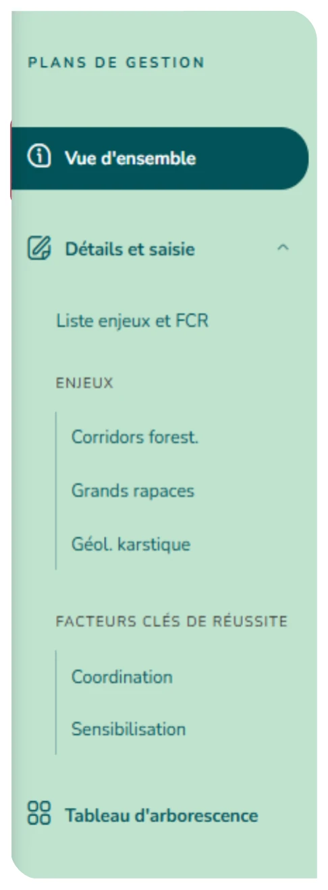
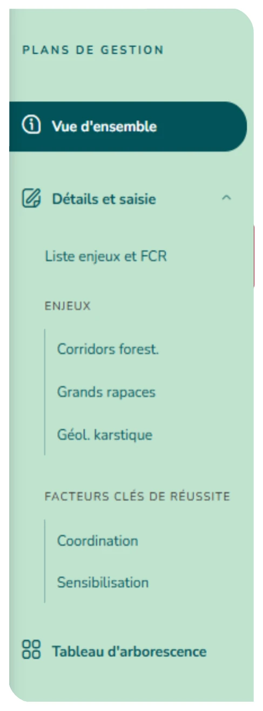
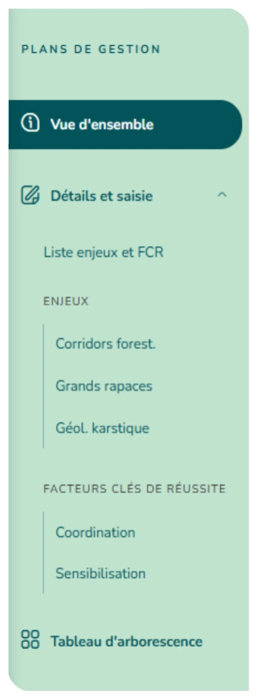

# 4.2. La fiche d'un plan et sa navigation

La fiche d'un plan s'organise autour d'une barre latérale :

- Paramétrage : les Paramètres du plan (import, suppression de version) et les Postes / RH ;
- Vue d'ensemble : la synthèse du plan (enjeux, objectifs, actions, documents) ;
- Détails et saisie : la liste des enjeux et des facteurs clés de réussite (FCR) et leur contenu ;
- Suivis : bilan, suivi des actions, tableau de bord ;
- Tableau d'arborescence : une vue cartographiée de tout le plan ;
- Exports : les documents Word et Excel du plan.

Les rubriques Paramétrage, Suivis et Exports ne sont visibles que des référents du plan, du rédacteur général et des administrateurs.

La vue d'ensemble affiche les informations clés (période, organisme, statut, surface) et des sections dépliables : synthèse des enjeux, des objectifs long terme, des objectifs opérationnels, des actions, des suivis, ainsi que les sites, les utilisateurs (référents et membres) et les documents joints.

« Gérer les utilisateurs » ajoute ou retire des référents et des membres du plan. Retirer le dernier référent, ou le repasser membre, est possible mais demande une confirmation : le plan reste alors modifiable par les seuls administrateurs de l'organisme gestionnaire, le rédacteur général et le super administrateur.

<figure markdown="span">
{ loading=lazy }
<figcaption>Figure 29 : Vue d'ensemble</figcaption>
</figure>
<figure markdown="span">
{ loading=lazy }
<figcaption>Figure 30 : Liste enjeux et FCR</figcaption>
</figure>
<figure markdown="span">
{ loading=lazy }
<figcaption>Figure 31 : ENJEUX et FCR</figcaption>
</figure>
<figure markdown="span">
{ loading=lazy }
<figcaption>Figure 32 : Tableau d'arborescence</figcaption>
</figure>

