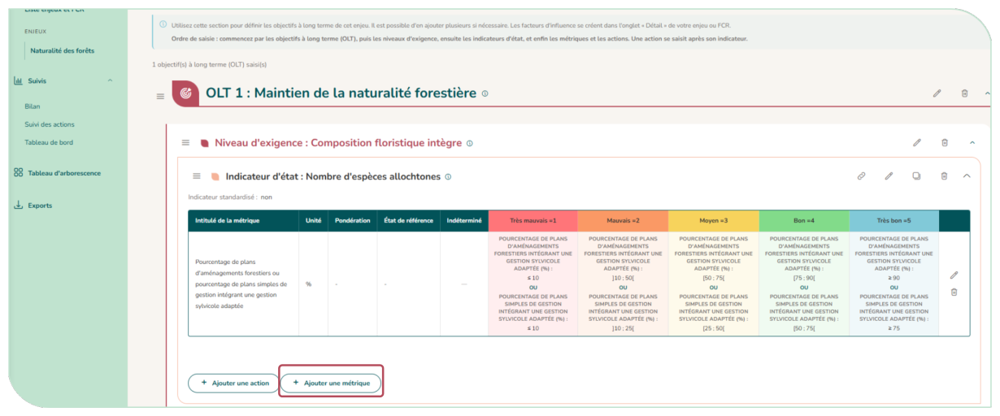
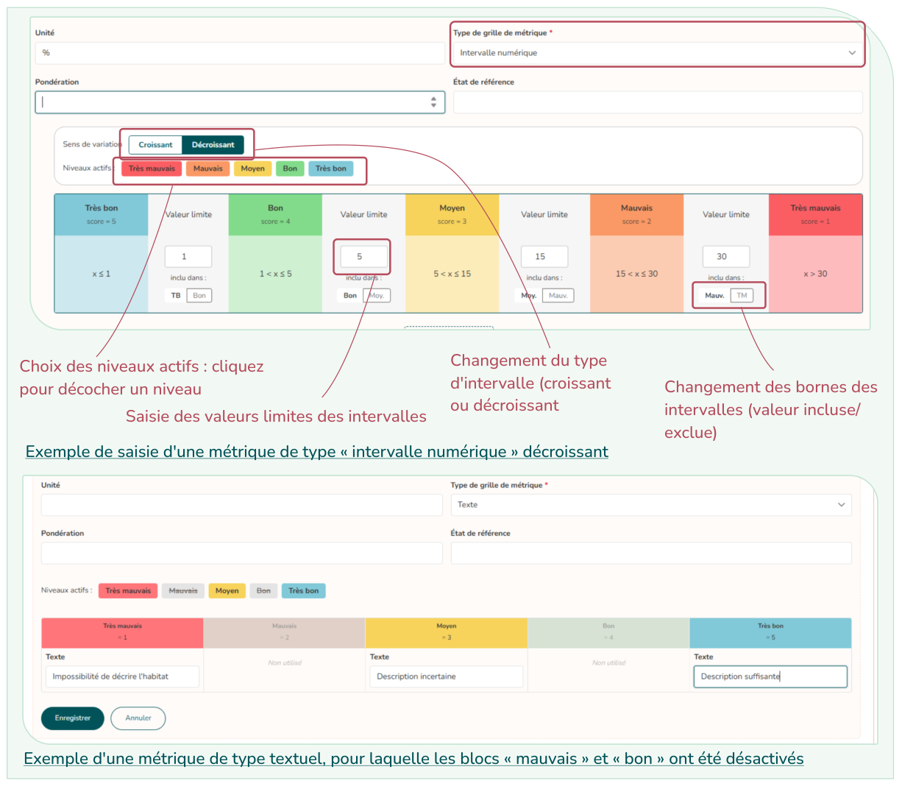
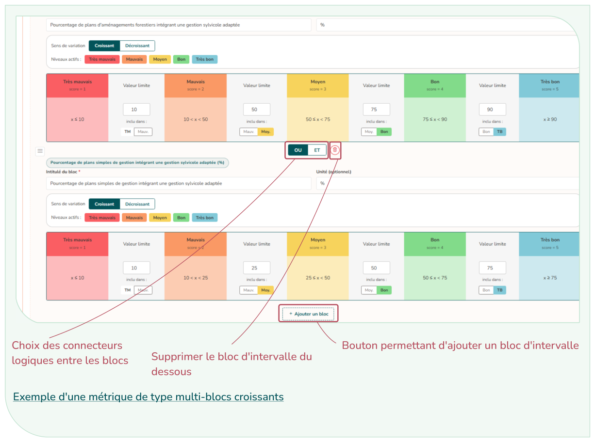

# 4.7. Les indicateurs et les métriques

Sous chaque niveau d'exigence, vous définissez des indicateurs d'état ; sous chaque résultat attendu, des indicateurs de pression ; les indicateurs de réponse se saisissent dans l'action. Chaque indicateur porte une ou plusieurs métriques : c'est la mesure concrète qui sera suivie dans le temps.

Une métrique comporte : un intitulé, une unité, une pondération, un état de référence et un type de grille (obligatoire), qui définit comment une valeur mesurée est convertie en score de 1 (très mauvais) à 5 (très bon) :

| Type de grille | Principe |
|----------------|----------|
| **Intervalle numérique** | Des valeurs limites séparent les niveaux. Vous choisissez le sens (croissant ou décroissant) et, pour chaque limite, à quel niveau elle appartient (borne incluse ou exclue). |
| **Chiffre** | Une valeur chiffrée par niveau. |
| **Texte** | Un libellé par niveau (ex. « absent », « présent », « abondant »). |
| **Indéterminé** | La grille sera définie plus tard, une fois le type de mesure précisé. |

<em style="color:#025359;font-size:0.78rem">Figure 42 : Les différents types de grilles de métriques</em>

Vous pouvez désactiver les niveaux inutiles (« Non utilisé »).

**Métriques à plusieurs blocs.** Avec une grille « Intervalle numérique », le bouton « Ajouter un bloc » permet de combiner plusieurs mesures (ex. hauteur ET densité). Chaque bloc a son intitulé, son unité et sa grille ; les blocs sont reliés par ET (on retient le moins bon score) ou OU (on retient le meilleur), avec des parenthèses si besoin.

<figure markdown="span">
{ loading=lazy }
<figcaption>Figure 43 : Saisie de la vision à long terme</figcaption>
</figure>

<figure markdown="span">
{ loading=lazy }
{ loading=lazy }
<figcaption>Figure 44 : Planche explicative de la saisie de la grille de métrique des indicateurs</figcaption>
</figure>
