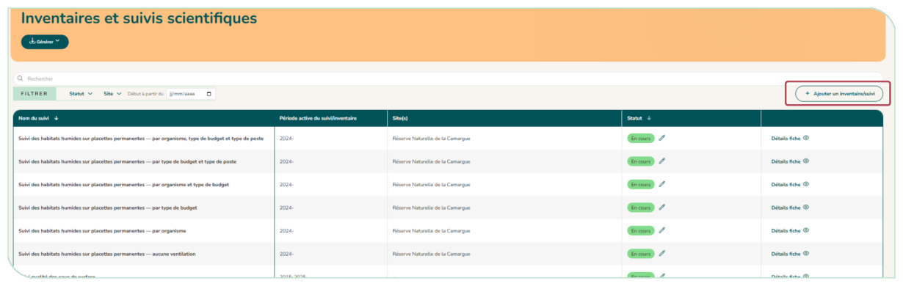

# 4.13. Le module Mes inventaires et suivis

**Le module « Mes inventaires et suivis » recense les inventaires et suivis scientifiques, qu'ils soient inscrits ou non dans un plan de gestion.** La liste peut être filtrée par statut (en cours, terminé, à venir), par site et par date de début. Si des actions de ce type sont saisies dans le module plan de gestion, elles apparaissent automatiquement dans ce module.

Le bouton « Ajouter un inventaire/suivi » ouvre un formulaire : intitulé, type, lien avec un plan de gestion et un indicateur, objectifs, cibles, date de lancement, statut, fréquence, protocoles (plusieurs possibles, standardisés ou non) et bancarisation de la donnée.

**Un suivi saisi ici peut ensuite être rattaché à une action de suivi** d'un plan : à la question « Inventaire ou suivi déjà saisi dans le module Mes inventaires et suivis ? », répondez « Oui » et choisissez-le dans la liste.

<figure markdown="span">
{ loading=lazy }
<figcaption>Figure 56 : Module Inventaires et suivis scientifiques</figcaption>
</figure>
