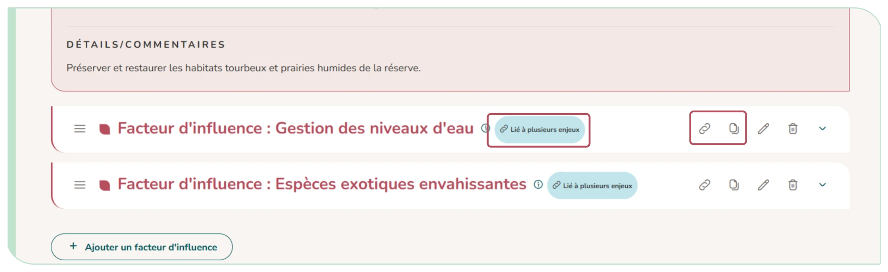

# 4.6. Lier ou copier un élément

Un même élément peut concerner plusieurs parties du plan (un facteur d'influence commun à deux enjeux, une action qui répond à plusieurs indicateurs…). Plutôt que de le saisir (puis suivre) deux fois, les boutons de partage proposent deux choix :

- **Lier :** l'élément reste unique et s'affiche à plusieurs endroits. Toute modification se répercute partout. Un badge (« Lié à plusieurs enjeux », « Liée à plusieurs métriques »…) le signale.
- **Copier** : crée un duplicata indépendant (avec tout son contenu), modifiable séparément.

Sont concernés : les facteurs d'influence, les objectifs opérationnels, les résultats attendus, les actions et les indicateurs (pour un indicateur, la copie se fait par « Dupliquer cet indicateur »). Un élément lié peut être retiré d'un emplacement (« Retirer d'ici ») sans être supprimé des autres.

Depuis un indicateur, « Ajouter une action » propose de créer une nouvelle action, de lier une action existante ou d'en copier une.

<figure markdown="span">
{ loading=lazy }
<figcaption>Figure 41 : Icônes copier ou lier</figcaption>
</figure>
