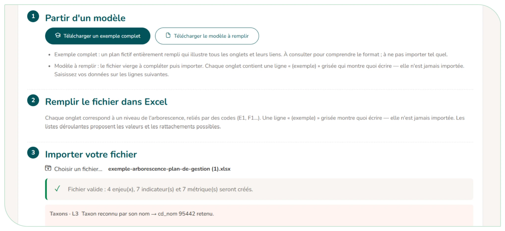
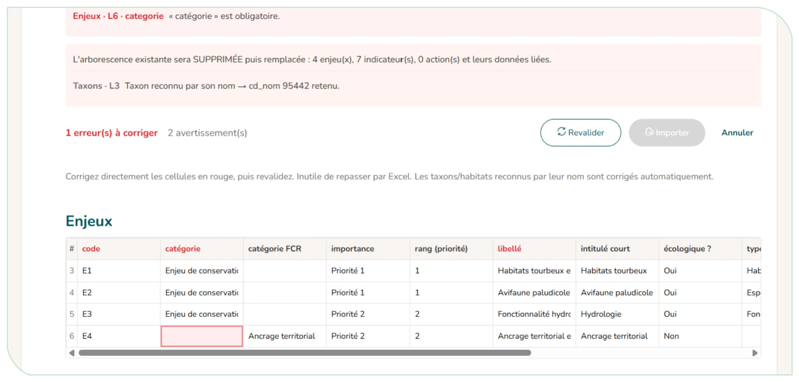

# 4.3. Le paramétrage du plan

## 4.3.1. Les postes (ressources humaines)

La page Postes / RH décrit les types de postes qui travaillent sur le plan : leur fonction, le nombre de personnes, leur organisme et le coût jour de chaque personne. Aucune donnée nominative n'est enregistrée (RGPD) : un poste est décrit par sa fonction, pas par la personne qui l'occupe.

Cliquez sur « Ajouter un type de poste » puis :

- Choisissez la fonction (si elle manque, « ajouter une nouvelle fonction » : elle ne sera proposée que dans ce plan). Chaque fonction est associée à une des 5 catégories suivantes : salarié, stagiaire, bénévole, partenaire ou prestataire ;
- Indiquez le nombre de personnes ayant la même fonction ;
- Pour les salariés et stagiaires : l'organisme et le coût jour de chaque personne ;
- Pour les bénévoles : un coût jour de 0 est mis par défaut, mais il est possible de le modifier ;
- Pour un prestataire ou un partenaire : l'organisme en texte libre ;
- Éventuellement, un nom local du poste (ex. « garde du secteur nord »), qui remplace la fonction dans les fiches action, et un commentaire (il est recommandé d'éviter l'utilisation des noms ou prénoms, par soucis de respect du RGPD).

**Ces postes alimentent ensuite le temps de travail des actions et le calcul automatique du coût salarial (jours × coût jour).**

<figure markdown="span">
{ loading=lazy }
<figcaption>Figure 33 : Page et fenêtre d'ajout de postes/RH</figcaption>
</figure>

## 4.3.2. Importer un plan depuis un fichier Excel

Pour reprendre un plan existant sans tout ressaisir à la main, la page « Paramètres » propose deux imports, l'arborescence et les fiches action. L'import n'est possible que sur un plan en brouillon.

- **Import de l'arborescence (enjeux, facteurs, pressions, objectifs, indicateurs, métriques) :**

1. **Partir d'un modèle** : téléchargez le modèle à remplir et/ou un exemple complet pour vous inspirer.
2. **Remplir le fichier dans Excel** : les onglets sont reliés par des codes (E1, F1…) et des listes déroulantes vous guident.
3. **Importer votre fichier** : CICADA vérifie le fichier et affiche soit « Fichier valide » avec le nombre d'éléments qui seront créés, soit la liste des anomalies (onglet, ligne, colonne).

Si le plan contient déjà une arborescence, vous choisissez d'ajouter le contenu du fichier à l'existant ou de remplacer tout le contenu (action irréversible, une confirmation est demandée).

4. **Corriger sans repasser par Excel** : le bouton « Corriger dans un tableau » affiche le contenu du fichier à l'écran, cellules en erreur en rouge. Corrigez-les directement, cliquez sur « Revalider », puis « Importer ».
5. **Import des actions** : même principe, avec le classeur des actions (actions, lignes de budget et de ressources humaines).

<figure markdown="span">
{ loading=lazy }
<figcaption>Figure 34 : Import de l'arborescence - statut valide</figcaption>
</figure>

<figure markdown="span">
{ loading=lazy }
<figcaption>Figure 35 : Import de l'arborescence - correction dans un tableau</figcaption>
</figure>

!!! tip "Mon plan d'origine est dans un tableau qui ne suit pas le modèle, que faire ?"

    A ce stade il n'est pas possible de permettre un import, à partir d'un modèle différent de celui fourni. Dans cette situation, il est recommandé de passer par la saisie manuelle du plan de gestion.

## 4.3.3. Supprimer une version

La suppression d'une version se fait aussi via la page « Paramètres ». **Cela efface définitivement son contenu** (enjeux, actions, suivis, fichiers) et ses liens ; les versions restantes sont renumérotées. <u>**Cette action est irréversible.**</u>
