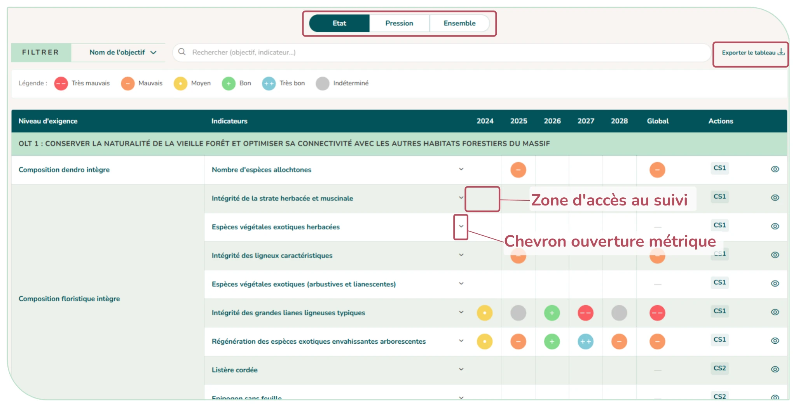
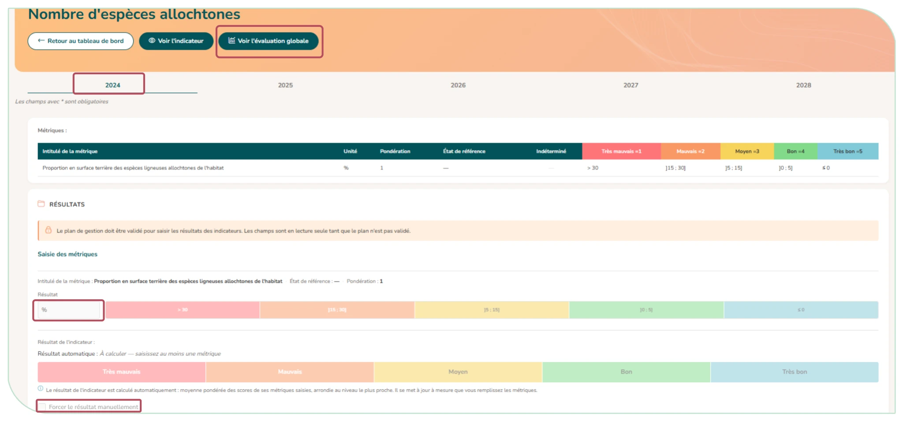
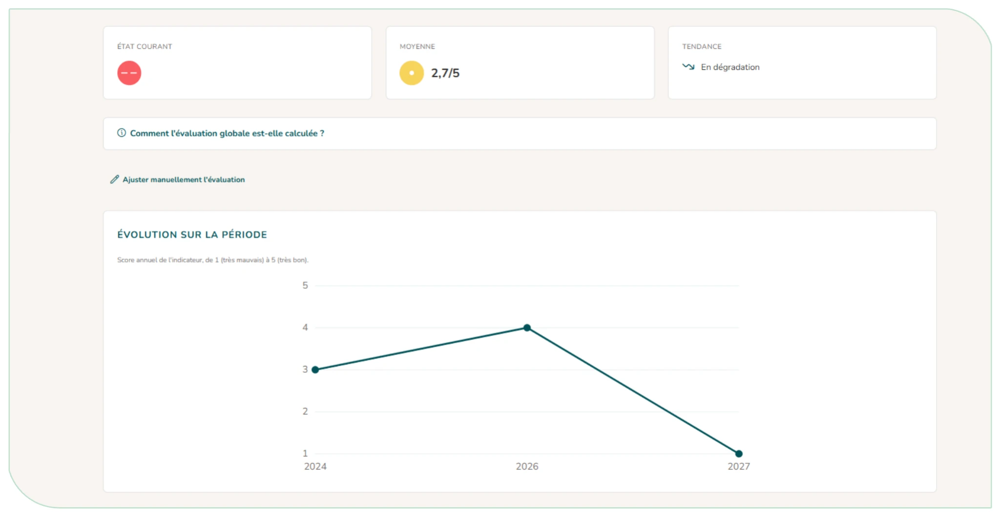
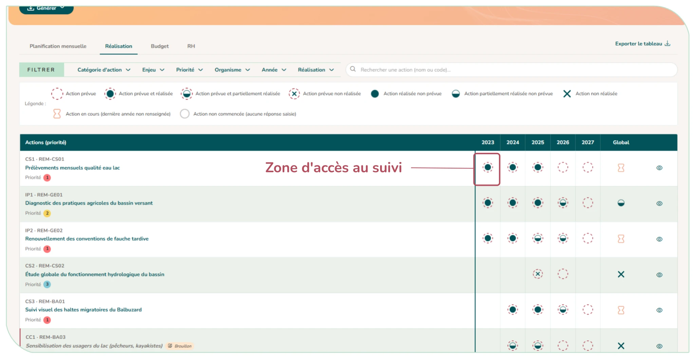
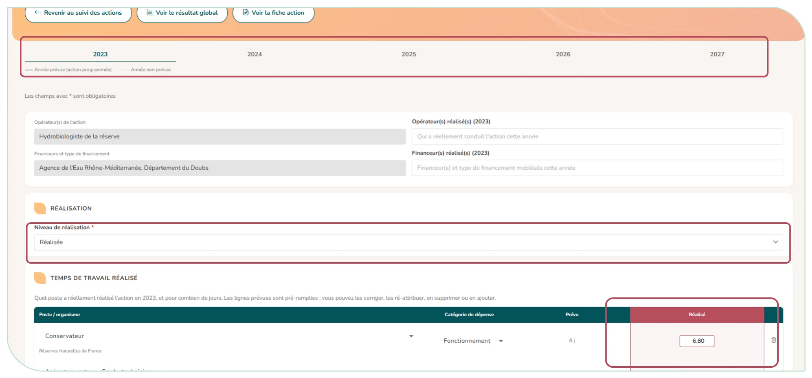
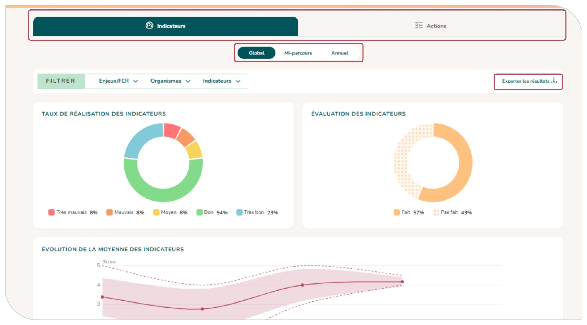

# 4.9. Le suivi du plan de gestion

Le menu « Suivis » propose trois vues complémentaires : « Tableau de bord », « Suivi des actions » et « Bilan ». Les référents du plan, les rédacteurs généraux et les administrateurs les saisissent. Les membres du plan et les utilisateurs rattachés à l'un de ses sites les consultent en lecture seule (un bandeau « Consultation seule » le rappelle), sans boutons d'export ; le rédacteur externe n'y a pas accès. **La saisie du suivi n'est possible que lorsque le plan est validé (ou modifié).**

## 4.9.1. Le tableau de bord et le suivi des indicateurs état et pression

Une grille objectifs × années affiche, par année, le score de chaque indicateur (de « Très mauvais » à « Très bon », ou « Indéterminé »).

- Trois volets de visualisation du tableau de bord sont disponibles : État (objectifs à long terme et niveaux d'exigence), Pression (objectifs opérationnels et résultats attendus) ou Ensemble (regroupé par enjeu).
- Pour chaque volet, des filtres sont disponibles afin d'en affiner la visualisation selon votre besoin (par objectif et par enjeu) ainsi qu'une barre de recherche.
- Un chevron permet de déplier les métriques de chaque indicateur.
- La colonne « Global » donne l'évaluation sur toute la période ; la colonne « Actions » liste les actions liées à l'indicateur.
- « Exporter le tableau » produit un fichier Excel mis en forme, selon la vue et les filtres en cours.

**On accède à la zone de saisie du suivi d'un indicateur en cliquant sur la case de l'année sur laquelle le suivi est souhaité dans le tableau de bord.**

<figure markdown="span">
{ loading=lazy }
<figcaption>Figure 48 : Tableau de bord des indicateurs état et pression</figcaption>
</figure>

Pour saisir le résultat d'un indicateur, il suffit de saisir dans l'année correspondante, pour chaque métrique paramétrée, le résultat. Le résultat de l'indicateur est auto calculé et correspond à la moyenne des résultats des métriques. Si une pondération des métriques a été paramétrée, celle-ci est prise en compte dans le calcul.

Le gestionnaire peut faire le choix de changer le résultat de l'indicateur. Dans ce cas, un champs s'ouvre et permet d'indiquer la raison de cette modification manuelle.

Une fois enregistré, le résultat apparaît dans le tableau de bord.

<figure markdown="span">
{ loading=lazy }
<figcaption>Figure 49 : Suivi des indicateurs</figcaption>
</figure>

En cliquant sur la case de l'indicateur de la colonne « Global », vous accédez à la page d'évaluation globale de l'indicateur. Vous pouvez aussi y accéder via le bouton « Voir l'évaluation globale » sur la page de suivi d'un indicateur (Figure 49). Là encore, le résultat est auto-calculé mais vous pouvez le changer manuellement. Un graphique permettant d'avoir un visuel de la tendance sur toute la période du plan de gestion est aussi disponible.

<figure markdown="span">
{ loading=lazy }
<figcaption>Figure 50 : Page de visualisation et suivi global d'un indicateur</figcaption>
</figure>

## 4.9.2. Le suivi des actions de gestion

Une grille actions × années pour saisir la réalisation des actions, ainsi que le budget et les ressources humaines consommés est accessible en cliquant sur « Suivi des actions » de la barre latérale. Quatre onglets sont disponibles sur la page : Planification mensuelle, Réalisation, Budget, RH. Ils présentent :

- **Des filtres** : catégorie d'action, enjeu, priorité, organisme, année et réalisation (réalisées / non réalisées), et recherche par nom ou code.
- **Une légende de réalisation :** action prévue ; prévue et réalisée ; prévue et partiellement réalisée ; prévue non réalisée ; réalisée non prévue ; partiellement réalisée non prévue ; en cours (sablier) ; non commencée.
- **Une colonne « Global »** qui donne la **réalisation sur toute la période** et ouvre la page globale de l'action.
- **Onglets Budget et RH :** pour l'année de référence choisie, la période écoulée et le total du plan, le prévisionnel et le réalisé, avec l'écart (montant restant en vert, dépassé en rouge).
- **Planification mensuelle** : vue Agenda (ce mois-ci, le mois prochain, cette année) ou vue Calendrier (une ligne par action, douze mois).
- « **Exporter le tableau** » produit un fichier Excel **selon l'onglet et les filtres en cours.** Depuis l'onglet « Réalisation », chaque case d'année y porte le **même pictogramme qu'à l'écran**, et la légende des pictogrammes figure en tête du fichier.
- **Voir la fiche action,** en cliquant sur l'icône œil.

### Saisir la réalisation d'une action

**On accède à la zone de saisie du suivi des actions en cliquant sur la case de l'année sur laquelle le suivi est souhaitée dans le tableau de l'onglet « Réalisation ».**

Pour chaque année, vous pouvez renseigner :

- **Le niveau de réalisation** : réalisée, partiellement réalisée ou non réalisée ;
- **Les opérateurs et financeurs** effectifs de l'année ;
- **Le temps de travail réalisé** (saisi avant le budget, car il calcule le coût salarial), puis le **budget réalisé**. Deux cases, au-dessus du tableau du budget, règlent sa saisie pour **toutes les années de l'action**, indépendamment de la programmation :
    - « **Déclinaison par type de coût** » : détaille le réalisé en coût salarial, stage, prestataire et autres coûts, même si l'action a été programmée en totaux (le prévu n'est alors rappelé qu'en totaux). Si la programmation est déclinée par type de coût, la case est cochée et ne peut pas être décochée ;
    - « **Saisie automatique du coût salarial** » (dès que le réalisé est décliné par type de coût) : décochée, le coût salarial réalisé se saisit à la main, même si la programmation le calculait — le coût jour réel diffère souvent du prévu ;
- Un commentaire, l'emprise réalisée (le bouton « Copier l'emprise prévue » reprend l'emprise programmée) et les valeurs des indicateurs de réponse.

Les onglets d'années couvrent toute la durée du plan : saisir une année non prévue enregistre une action réalisée non prévue.

Pour une action **programmée globalement sur sa période** (voir [§ 4.8.1](actions.md#481-la-saisie-dune-action-de-gestion)), le réalisé se saisit toujours année par année, mais le tableau ne rappelle pas de prévu par année : deux encadrés au-dessus du tableau donnent le budget et le temps de travail prévus pour la période, face au réalisé enregistré toutes années confondues.

Comme à la saisie de l'action, la catégorie de dépense du temps réalisé (fonctionnement, investissement, bénévolat partenariat) n'est demandée que si le mode de ventilation inclut le type de budget. Dans les onglets Budget et RH du suivi des actions, son prévu ne compte que dans la colonne du total du plan.

La page globale d'une action récapitule sa réalisation, son budget et son temps de travail année par année. Le bouton « Ajuster manuellement la réalisation » permet de forcer la réalisation globale et d'ajouter un commentaire global.

<figure markdown="span">
{ loading=lazy }
<figcaption>Figure 51 : Suivi des actions</figcaption>
</figure>

<figure markdown="span">
{ loading=lazy }
<figcaption>Figure 52 : Saisie de la réalisation d'une action</figcaption>
</figure>

## 4.9.3. Le bilan de la gestion

Le « **Bilan de la gestion** » **synthétise les résultats du suivi du plan de gestion**, selon trois temporalités : Global, Mi-parcours (première moitié du plan) ou Annuel (une année choisie), et peut être filtré par enjeu / FCR. Les différents graphiques ou chiffres clefs sont générés automatiquement en fonction des éléments de suivi saisis (suivi des indicateurs via le tableau de bord et suivi des actions de gestion).

- **Onglet Indicateurs** : répartition des scores, évaluation des indicateurs, évolution de la moyenne (avec minimum, maximum et écart-type) et graphique radar par enjeu.
- **Onglet Actions** : budget prévisionnel et réel (détaillé en fonctionnement et investissement si au moins une action du plan ventile par type de budget), jours de RH, taux de réalisation, niveau de réalisation par catégorie d'action, par enjeu et par année.
- « **Exporter les résultats** » : les résultats chiffrés (fichier CSV, lisible dans Excel) ou les graphiques (image JPG), selon les filtres en cours.

<figure markdown="span">
{ loading=lazy }
<figcaption>Figure 53 : Bilan de la gestion</figcaption>
</figure>
