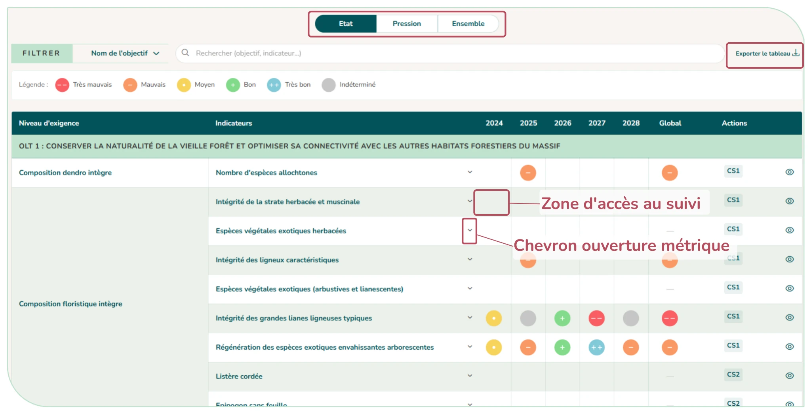
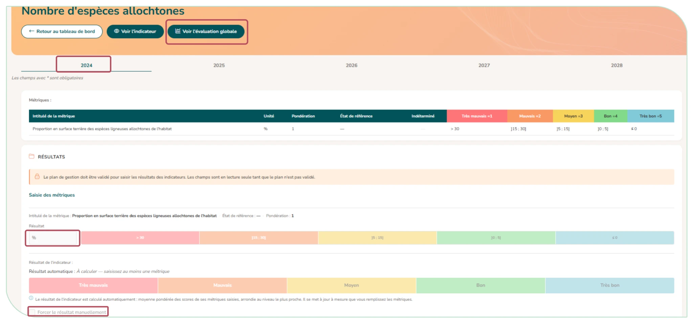
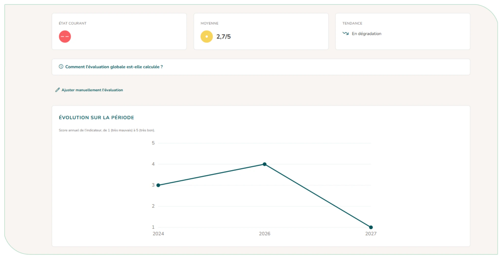
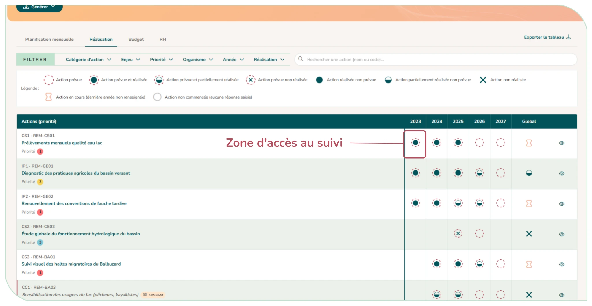
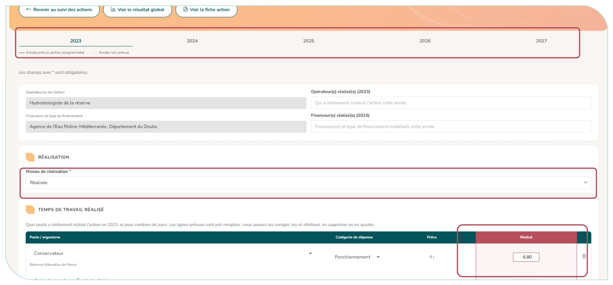
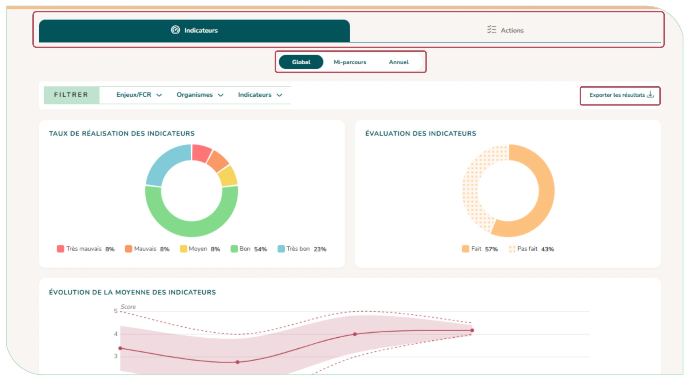

# 4.9. Le suivi du plan de gestion

Le menu « Suivis » propose quatre vues complémentaires : « Tableau de bord », « Suivi des actions », « Bilan » et « Ajustement planification annuelle ». Les référents du plan, les rédacteurs généraux et les administrateurs les saisissent. Les membres du plan et les utilisateurs rattachés à l'un de ses sites les consultent en lecture seule (un bandeau « Consultation seule » le rappelle), sans boutons d'export ; le rédacteur externe n'y a pas accès. **La saisie du suivi n'est possible que lorsque le plan est validé (ou modifié).**

## 4.9.1. Le tableau de bord et le suivi des indicateurs état et pression

Une grille objectifs × années affiche, par année, le score de chaque indicateur (de « Très mauvais » à « Très bon », ou « Indéterminé »).

- Trois volets de visualisation du tableau de bord sont disponibles : État (objectifs à long terme et niveaux d'exigence), Pression (objectifs opérationnels et résultats attendus) ou Ensemble (regroupé par enjeu).
- Pour chaque volet, des filtres sont disponibles afin d'en affiner la visualisation selon votre besoin (par objectif et par enjeu) ainsi qu'une barre de recherche.
- Un chevron permet de déplier les métriques de chaque indicateur.
- La colonne « Global » donne l'évaluation sur toute la période ; la colonne « Actions » liste les actions liées à l'indicateur.
- « Exporter le tableau » produit un fichier Excel mis en forme, selon la vue et les filtres en cours.

**On accède à la zone de saisie du suivi d'un indicateur en cliquant sur la case de l'année sur laquelle le suivi est souhaité dans le tableau de bord.**

<figure markdown="span">
{ loading=lazy }
<figcaption>Figure 48 : Tableau de bord des indicateurs état et pression</figcaption>
</figure>

Pour saisir le résultat d'un indicateur, il suffit de saisir dans l'année correspondante, pour chaque métrique paramétrée, le résultat. Le résultat de l'indicateur est auto calculé et correspond à la moyenne des résultats des métriques. Si une pondération des métriques a été paramétrée, celle-ci est prise en compte dans le calcul.

Le gestionnaire peut faire le choix de changer le résultat de l'indicateur. Dans ce cas, un champs s'ouvre et permet d'indiquer la raison de cette modification manuelle.

Une fois enregistré, le résultat apparaît dans le tableau de bord.

<figure markdown="span">
{ loading=lazy }
<figcaption>Figure 49 : Suivi des indicateurs</figcaption>
</figure>

En cliquant sur la case de l'indicateur de la colonne « Global », vous accédez à la page d'évaluation globale de l'indicateur. Vous pouvez aussi y accéder via le bouton « Voir l'évaluation globale » sur la page de suivi d'un indicateur (Figure 49). Là encore, le résultat est auto-calculé mais vous pouvez le changer manuellement. Un graphique permettant d'avoir un visuel de la tendance sur toute la période du plan de gestion est aussi disponible.

<figure markdown="span">
{ loading=lazy }
<figcaption>Figure 50 : Page de visualisation et suivi global d'un indicateur</figcaption>
</figure>

## 4.9.2. Le suivi des actions de gestion

Une grille actions × années pour saisir la réalisation des actions, ainsi que le budget et les ressources humaines consommés est accessible en cliquant sur « Suivi des actions » de la barre latérale. Quatre onglets sont disponibles sur la page : Planification mensuelle, Réalisation, Budget, RH. Ils présentent :

- **Des filtres** : catégorie d'action, enjeu, priorité, organisme, année et réalisation (réalisées / non réalisées), et recherche par nom ou code.
- **La planification annuelle ajustée** ([§ 4.9.4](#494-lajustement-de-la-planification-annuelle)) fait foi pour le prévu : une action reportée n'est plus prévue l'année d'origine mais l'année du report, une action planifiée hors du plan de gestion apparaît prévue, et la planification mensuelle montre les mois ajustés.
- **Une légende de réalisation :** action prévue ; prévue et réalisée ; prévue et partiellement réalisée ; prévue non réalisée ; réalisée non prévue ; partiellement réalisée non prévue ; en cours (sablier) ; non commencée.
- **Une colonne « Global »** qui donne la **réalisation sur toute la période** et ouvre la page globale de l'action.
- **Onglets Budget et RH :** pour l'année de référence choisie, la période écoulée (du début du plan jusqu'à l'année de référence incluse) et le total du plan, trois colonnes :
    - le **prévu du plan de gestion** ;
    - le **prévu ajusté** par la planification annuelle ([§ 4.9.4](#494-lajustement-de-la-planification-annuelle)), en relief quand il s'écarte du plan ; les années non ajustées reprennent le plan ;
    - le **réalisé**, avec l'écart au prévu ajusté (montant restant en vert, dépassé en rouge).

    Pour une action programmée globalement sur sa période, le prévu du plan de gestion ne se répartit pas par année : il est noté « / » sur l'année et la période écoulée, et ne figure que dans le total du plan. Son prévu ajusté est celui saisi pour chaque année ajustée. L'onglet RH ne compte que le temps des agents : le temps bénévole ou partenaire n'entre pas dans ces totaux, ni dans ceux de la vue globale d'une action.
- **Planification mensuelle** : vue Agenda (ce mois-ci, le mois prochain, cette année) ou vue Calendrier (une ligne par action, douze mois).
- « **Exporter le tableau** » produit un fichier Excel **selon l'onglet et les filtres en cours.** Depuis l'onglet « Réalisation », chaque case d'année y porte le **même pictogramme qu'à l'écran**, et la légende des pictogrammes figure en tête du fichier.
- **Voir la fiche action,** en cliquant sur l'icône œil.

### Saisir la réalisation d'une action

**On accède à la zone de saisie du suivi des actions en cliquant sur la case de l'année sur laquelle le suivi est souhaitée dans le tableau de l'onglet « Réalisation ».**

Le bouton « **Exporter la fiche de suivi** », en tête de page, télécharge la fiche Excel de l'action pour l'année affichée : prévu et réalisé côte à côte (voir [§ 4.12](exports.md)). Il est réservé, comme tous les exports, aux référents du plan et aux gestionnaires.

Pour chaque année, vous pouvez renseigner :

- **Le niveau de réalisation** : réalisée, partiellement réalisée ou non réalisée ;
- **Les opérateurs et financeurs** effectifs de l'année ;
- **Les montants par financeur** de l'année (facultatifs). Le tableau rappelle les financeurs prévus par l'action et leur montant prévu, qui est global : il se compare au total réalisé de toutes les années, dans la fiche action. « Ajouter un financeur non prévu » propose les autres financeurs du plan ;
- **Le temps de travail réalisé** (saisi avant le budget, car il calcule le coût salarial). La case « **Déclinaison par type de poste** », au-dessus du tableau, règle sa saisie pour toutes les années de l'action : décochée, le temps se saisit en un temps total (ou par organisme si le budget est ventilé par organisme) ; cochée, il se saisit poste par poste, et chaque ligne doit alors indiquer son poste. Si le temps a été programmé sans poste (temps total ou par organisme), ce prévu reste affiché sur une ligne de rappel en lecture seule et compte dans le total prévu, mais n'est attribué à aucun poste : le réalisé se saisit sur les lignes de poste en dessous. Elle est décochée par défaut, sauf si la programmation est déclinée par poste : elle est alors cochée et ne peut pas être décochée ;
- Puis le **budget réalisé**. Deux cases, au-dessus du tableau du budget, règlent sa saisie pour **toutes les années de l'action**, indépendamment de la programmation :
    - « **Déclinaison par type de coût** » : détaille le réalisé en coût salarial, stage, prestataire et autres coûts, même si l'action a été programmée en totaux (le prévu n'est alors rappelé qu'en totaux). Si la programmation est déclinée par type de coût, la case est cochée et ne peut pas être décochée ;
    - « **Saisie automatique du coût salarial** » (dès que le réalisé est décliné par type de coût) : décochée, le coût salarial réalisé se saisit à la main, même si la programmation le calculait — le coût jour réel diffère souvent du prévu ;
- Un commentaire, l'emprise réalisée (le bouton « Copier l'emprise prévue » reprend l'emprise programmée ; sinon « Dessiner / importer », puis « Tracer un contour » en haut à gauche de la carte ou « Importer » en haut à droite) et les valeurs des indicateurs de réponse.

Les onglets d'années couvrent toute la durée du plan : saisir une année non prévue enregistre une action réalisée non prévue.

Les cases « Déclinaison par type de poste » et « Déclinaison par type de coût » sont reprises du **premier suivi saisi dans le plan** : pour une action dont le suivi n'a encore jamais été saisi, elles sont proposées dans l'état de ce premier suivi (sauf si la programmation de l'action impose de les cocher). Ce n'est qu'une valeur par défaut, modifiable ; elle est enregistrée avec le premier suivi de l'action, et les suivis déjà enregistrés ne changent pas.

Chaque année s'ouvre avec ses propres données : une année jamais saisie s'affiche directement en saisie, vide, avec seulement les valeurs reprises de la programmation. Une année **déjà enregistrée** s'affiche en lecture : le bouton « **Modifier** », en haut à droite du formulaire, la repasse en saisie. À côté, « **Effacer la saisie de l'année** » supprime tout le suivi de cette année (niveau, budget, temps, emprise, commentaires) après confirmation : l'action revient à l'état « non encore saisie » et le formulaire repasse en saisie.

Pour une action **programmée globalement sur sa période** (voir [§ 4.8.1](actions.md#481-la-saisie-dune-action-de-gestion)), le réalisé se saisit toujours année par année, mais le tableau ne rappelle pas de prévu par année : deux encadrés au-dessus du tableau donnent le budget et le temps de travail prévus pour la période, face au réalisé enregistré toutes années confondues.

Comme à la saisie de l'action, la catégorie de dépense du temps réalisé (fonctionnement, investissement, bénévolat partenariat) n'est demandée que si le mode de ventilation inclut le type de budget. Dans les onglets Budget et RH du suivi des actions, son prévu ne compte que dans la colonne du total du plan.

La page globale d'une action récapitule sa réalisation, son budget et son temps de travail année par année. Le prévu y est celui de la planification ajustée : quand il s'écarte du plan de gestion, il est souligné en pointillé et la valeur du plan s'affiche au survol. Le bouton « Ajuster manuellement la réalisation » permet de forcer la réalisation globale et d'ajouter un commentaire global.

<figure markdown="span">
{ loading=lazy }
<figcaption>Figure 51 : Suivi des actions</figcaption>
</figure>

<figure markdown="span">
{ loading=lazy }
<figcaption>Figure 52 : Saisie de la réalisation d'une action</figcaption>
</figure>

## 4.9.3. Le bilan de la gestion

Le « **Bilan de la gestion** » **synthétise les résultats du suivi du plan de gestion**, selon trois temporalités : Global, Mi-parcours (première moitié du plan) ou Annuel (une année choisie). Trois filtres, à choix multiple, affinent la lecture :

- **Enjeux/FCR** : un ou plusieurs enjeux et FCR ; les graphiques « par enjeu » ne montrent alors que ceux-là ;
- **Organismes** (onglet Actions) : les actions ventilées à ces organismes, avec le budget et le temps de travail de leur seule part ;
- **Type d'indicateur** (onglet Indicateurs) : indicateurs d'état, de pression, ou les deux (par défaut).

Dans les graphiques, les enjeux sont désignés par leur numéro (« Enjeu 1 », « FCR 1 »…), comme dans l'arborescence ; le nom complet s'affiche au survol. Les différents graphiques ou chiffres clefs sont générés automatiquement en fonction des éléments de suivi saisis (suivi des indicateurs via le tableau de bord et suivi des actions de gestion).

- **Onglet Indicateurs** (indicateurs d'état et de pression) : évaluation des indicateurs (répartition des scores), taux de réalisation (indicateurs évalués ou non), évolution de la moyenne (avec minimum, maximum et écart-type) et graphique radar par enjeu / FCR.
- **Onglet Actions** : budget prévisionnel et réel (détaillé en fonctionnement et investissement si au moins une action du plan ventile par type de budget), jours de RH, taux de réalisation, niveau de réalisation par catégorie d'action (grands types CS, IP, CO… : les sous-types comme CS.1.1 sont cumulés sous leur catégorie, dont le nom s'affiche au survol), par enjeu et par année.
- « **Exporter les résultats** » : les résultats chiffrés (fichier CSV, lisible dans Excel) ou les graphiques (image JPG), selon les filtres en cours.

<figure markdown="span">
{ loading=lazy }
<figcaption>Figure 53 : Bilan de la gestion</figcaption>
</figure>

## 4.9.4. L'ajustement de la planification annuelle

Le plan de gestion programme les actions sur toute sa durée : c'est la **référence**, et elle ne change plus une fois le plan validé. Chaque année, pourtant, chaque action est revue : ses coûts évoluent, ses moyens humains aussi, et elle peut être reportée ou faite plus tôt que prévu. La page « **Ajustement planification annuelle** » du menu « Suivis » présente, pour une année, la programmation de chaque action **telle que prévue au plan de gestion** et **telle qu'ajustée pour l'année**. Ajuster une année ne modifie jamais la fiche action ni le plan de gestion.

- **L'année** se choisit en tête de page (flèches ou liste des années du plan, prolongation comprise). À côté, « **X / Y actions revues pour l'année** » et une jauge montrent l'avancement de la revue : une action est revue dès que son ajustement de l'année a été enregistré, même sans rien changer.
- **Les filtres** : recherche par code ou intitulé, et statut — planifiées, reportées, non prévues, à revoir, ou qui divergent du plan de gestion.
- **Le tableau**, une ligne par action :
    - le **statut de l'année** : « Planifiée », « Non prévue », « Reportée en … » ou « Reste reporté en … » (action entamée cette année et finalisée plus tard). En dessous, les reports reçus d'une année précédente (« Reportée de … », « Reste de … ») et, en italique, ce que prévoyait le plan de gestion quand le statut ou les mois diffèrent ;
    - les **mois de réalisation** prévus pour l'année ;
    - le **budget et le temps de travail du plan de gestion**, puis ceux **ajustés pour l'année**, avec l'écart. Une action programmée globalement sur sa période affiche, côté plan de gestion, ses moyens « sur la période » : elle n'a pas de montant par année et ne compte pas dans le total du plan de gestion ;
    - la **revue** : une coche (date de la revue au survol) ou « À revoir ».
- **Le total** des actions affichées, plan de gestion et ajusté.

### Ajuster une action pour l'année

Cliquer sur le nom d'une action ouvre son ajustement pour l'année. En tête, son statut, sa revue et deux encadrés : la programmation du **plan de gestion** et la programmation **ajustée** pour l'année, recalculée à chaque saisie. On y ajuste :

- **Le statut** : « Planifiée » ou « Non prévue ». Une année non prévue n'a ni mois ni moyens. Repasser en « Planifiée » une année non prévue reprend la programmation du plan de gestion comme point de départ.
- **Les mois de réalisation** : les mois du plan de gestion sont encadrés en pointillé.
- **Le temps de travail** et **le budget**, présentés comme dans la fiche action, selon le mode de ventilation de l'action et ses réglages (déclinaison par poste, par type de coût, coût salarial calculé ou saisi). La valeur du plan de gestion est rappelée à côté de chaque champ. Le coût salarial calculé (jours × coût jour des postes) se met à jour avec le temps saisi. Un poste ou un organisme peut être ajouté ou retiré pour l'année.
- **Les financeurs** : un montant prévu pour l'année par financeur (facultatif), en regard du montant prévu par le plan de gestion sur toute l'action.
- **Un commentaire**, pour garder la raison de l'ajustement.

« **Enregistrer (action revue)** » enregistre l'ajustement et marque l'action revue pour l'année, même si rien n'a changé. « **Enregistrer et passer à la suivante** » enchaîne la revue action par action. « **Revenir au plan de gestion** » supprime l'ajustement de l'année : l'action reprend la programmation du plan et redevient à revoir. Pour une action programmée globalement sur sa période, le plan de gestion n'a pas de montant annuel : les moyens de l'année se saisissent ici.

### Reporter une action

« **Reporter…** » (une fois les modifications enregistrées) ouvre le choix de l'année cible et du type de report :

- **Report total** : l'action n'est pas faite cette année ; elle passe sur l'année choisie et toute la suite de sa programmation est décalée d'autant ;
- **Report du reste à faire** : l'action est entamée cette année ; elle reste planifiée, et l'année choisie reçoit le reste à faire (prévu moins réalisé) en plus de sa propre programmation.

« **Voir l'aperçu** » affiche, année par année, la programmation avant et après le report. Les années modifiées sont surlignées, et ce qui serait abandonné au-delà de la fin du plan est signalé. Rien n'est enregistré avant « **Confirmer le report** ». Une année reportée peut repasser en « Planifiée » ou « Non prévue » : le report est annulé, mais les années suivantes déjà décalées ne bougent pas.

### Les règles de l'ajustement

Sans ajustement, l'année reprend la programmation du plan de gestion. Les règles de l'ajustement :

- **Reporter une action** décale toute la suite de sa programmation d'autant, avec ses moyens et ses mois, que les années suivantes aient déjà été ajustées ou non. Une année où du réalisé a déjà été saisi ne bouge pas. Rien n'est programmé au-delà de la fin du plan de gestion (prolongation comprise) : ce qui tomberait après est abandonné. Un aperçu avant / après précède toujours le report.
- **Une action entamée une année et finalisée l'année suivante** reste planifiée la première année ; l'année suivante reçoit le reste à faire (prévu moins réalisé), en plus de ce qu'elle prévoyait déjà.
- **Une action faite plus tôt que prévu** est simplement planifiée l'année où elle est faite : les autres années ne bougent pas, à vous de les ajuster.
- **Une action absente du plan de gestion** ne s'ajoute pas ici : créez une nouvelle version du plan de gestion.

Comme le reste du suivi, la page est consultable par les utilisateurs liés au plan et l'ajustement est réservé aux référents du plan et aux gestionnaires, une fois le plan validé.
