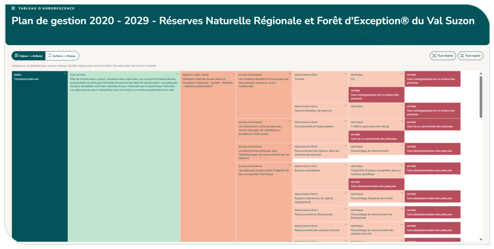

# 4.10. Le tableau d'arborescence

Le **tableau d'arborescence** offre une vue d'ensemble cartographiée du plan : du plan vers les enjeux, les objectifs, les indicateurs et les actions. Un clic sur un élément permet de zoomer dessus (« Vue d'ensemble » pour revenir), un double-clic ouvre sa fiche. Vous pouvez replier/déplier les branches (ou « Tout déplier » / « Tout replier ») et basculer entre la vue « Enjeux → Actions » et la vue « Actions → Enjeux ».

<figure markdown="span">
{ loading=lazy }
<figcaption>Figure 54 : Tableau d'arborescence</figcaption>
</figure>
