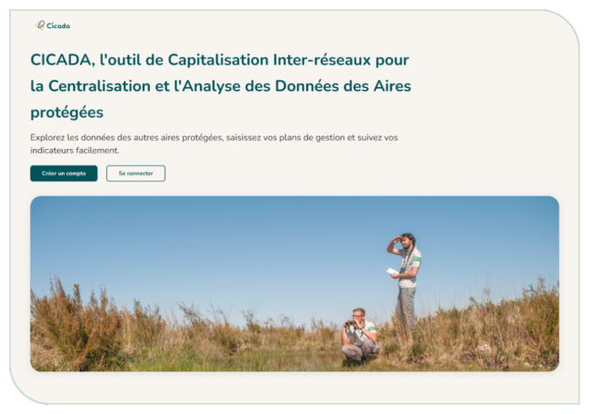

# 1. Contexte et consignes de lecture

CICADA est un outil numérique **open source** destiné à accompagner, entre autres, les gestionnaires d'aires protégées dans la **saisie et le suivi de leurs plans de gestion** selon la méthodologie **CT88**.

<figure markdown="span" class="figure--medium">
{ loading=lazy }
<figcaption>Figure 1 : Page d'accueil de CICADA - instance de RNF</figcaption>
</figure>

Développé par **Réserves Naturelles de France (RNF)** et la **Fédération des Conservatoires d'espaces naturels (FCEN)**, en partenariat avec la Ligue pour la protection des oiseaux (LPO), PatriNat et l'Office français de la biodiversité (OFB) dans le cadre du programme européen **LIFE Biodiv'France**, CICADA vise à structurer le travail des gestionnaires tout en facilitant la remontée et la valorisation des données à l'échelle des réseaux.

À ce jour, l'outil permet la saisie, le suivi et l'exploration des plans de gestion. Le module « Zonages réglementaires » sera développé en 2027. D'autres modules pourront aussi voir le jour ultérieurement, au gré des besoins et moyens disponibles.
