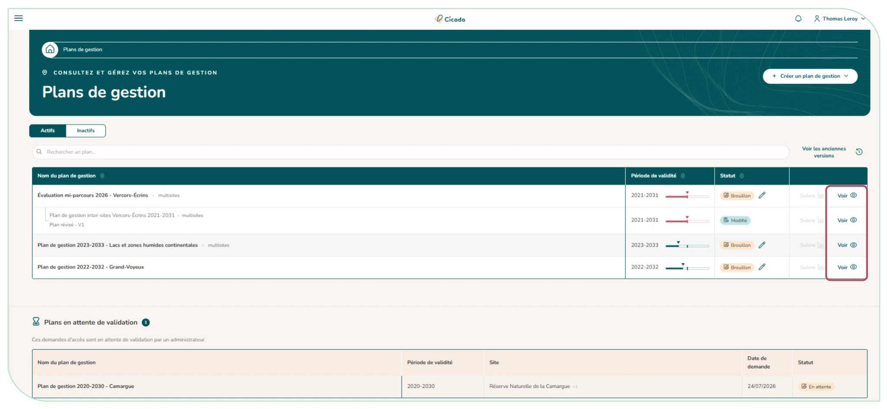
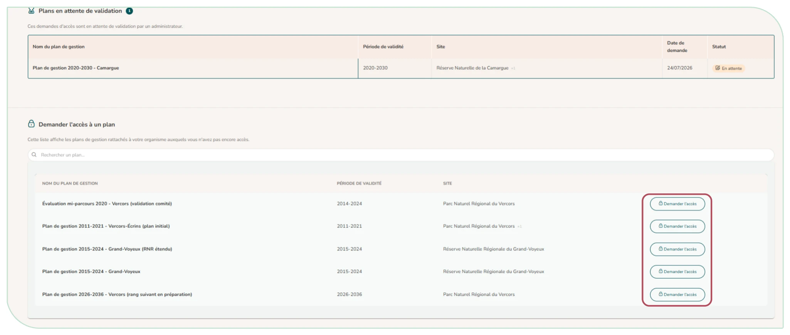

# 3.6. Consulter les plans de gestion

Le module « **Mes plans de gestion** » permet d'accéder aux plans de gestion auxquels vous avez accès via la liste de la page d'accueil du module. En tant qu'utilisateur, vous consultez les plans **en lecture seule** : vous ne pouvez pas les modifier, mais vous accédez à toute leur richesse (enjeux, objectifs, actions, indicateurs). Si vous êtes membre du plan ou rattaché à l'un de ses sites, vous consultez aussi tout son suivi (menu « Suivis » : tableau de bord, suivi des actions, bilan), sans pouvoir le saisir ni l'exporter.

!!! tip ""

    Si vous souhaitez consulter les arborescences des plans de gestion pour lesquels vous n'avez pas de droit d'accès direct, vous pouvez aller interroger le module « **Exploration des données des plans de gestion** » ([§ 3.8](exploration.md)).

Vous pouvez rechercher, trier et filtrer (plans actifs / inactifs). En cliquant sur un plan, vous ouvrez sa **fiche détaillée** : informations générales, enjeux, sites associés.

<figure markdown="span">
{ loading=lazy }
<figcaption>Figure 20 : Page d'accueil - module plan de gestion - tableau des plans</figcaption>
</figure>

Pour demander l'accès à un plan de gestion existant, cliquez sur « **Demander l'accès** »

<figure markdown="span">
{ loading=lazy }
<figcaption>Figure 21 : Demande d'accès à un plan de gestion existant</figcaption>
</figure>
