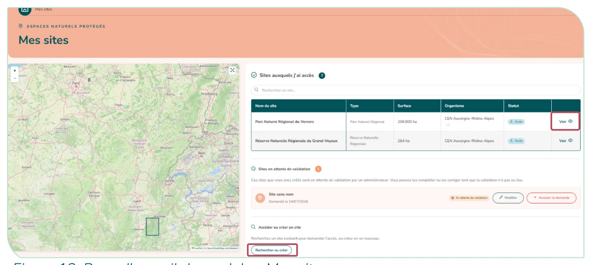
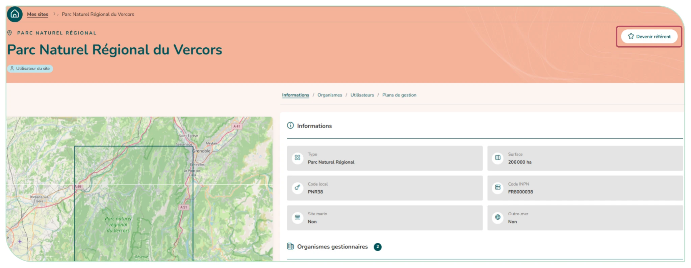

# 3.4. Consulter les sites

Le module « **Mes sites** » présente une carte (à gauche) et un tableau (à droite). **Par défaut, sont affichés dans le tableau vos sites.** La fiche d'un site est accessible en cliquant sur « voir » dans le tableau des sites.

<figure markdown="span" class="figure--medium">
{ loading=lazy }
<figcaption>Figure 13 : Page d'accueil du module « Mes sites »</figcaption>
</figure>

Cette fiche détaille les informations générales du sites, les organismes gestionnaires de celui-ci ainsi que les utilisateurs rattachés et les plans de gestion associés. Vous pouvez également demander à devenir référent d'un site auquel vous avez accès.

<figure markdown="span">
{ loading=lazy }
<figcaption>Figure 14 : Page détaillée d'un site</figcaption>
</figure>

!!! tip "Exporter des sites"
    Le bouton « **Exporter (GeoJSON)** » de la fiche d'un site télécharge son périmètre et ses attributs (nom, code INPN, code local, type, surface, organismes gestionnaires). Dans le module « Mes sites », « **Exporter les sites affichés (GeoJSON)** » fait de même pour les sites du tableau, selon l'onglet et la recherche en cours. Le fichier s'ouvre dans un SIG et se réimporte tel quel par l'[import en masse de sites](../../admin-organisme/import-masse.md), sur cette instance ou sur une autre. Les utilisateurs rattachés au site ne sont pas exportés.
