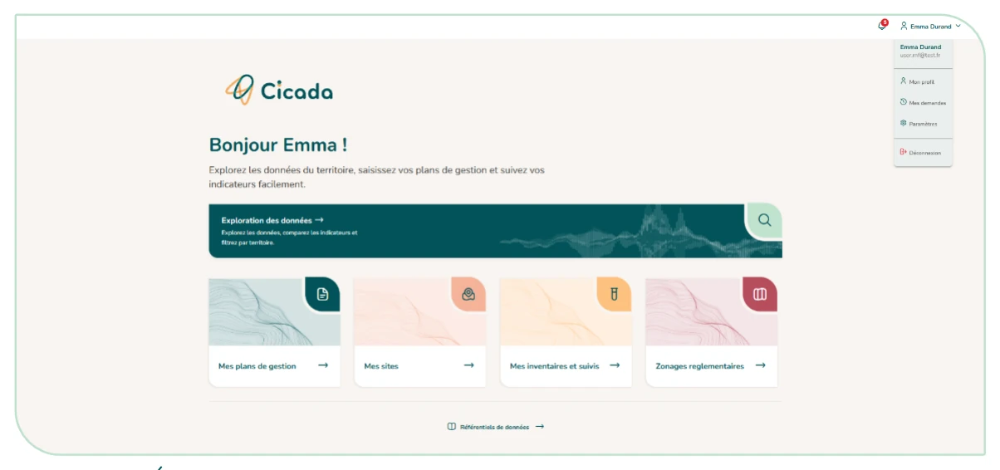

# 3.2. L'écran d'accueil

Une fois connecté, vous arrivez sur l'accueil qui affiche les tuiles de navigation vers les différents modules auxquels vous avez accès (« Mes plans de gestion », « Mes sites », « Exploration des données », « Zonages réglementaires » etc.). Cliquez sur une tuile pour ouvrir le module correspondant.

Sous les tuiles, le lien **« Référentiels de données »** ouvre la page des référentiels utilisés par les plans de l'instance. Elle couvre les types d'action (Gestref), les types de pression (PressRef), les taxons (TaxRef) et les habitats (HabRef). Pour chacun, elle indique la version en service et permet de télécharger ses données au format CSV (séparateur point-virgule, lisible par un tableur). Pour TaxRef et HabRef, un lien renvoie aussi à la source officielle de l'INPN.

<figure markdown="span" class="figure--medium">
{ loading=lazy }
<figcaption>Figure 5 : Écran d'accueil : connecté</figcaption>
</figure>
