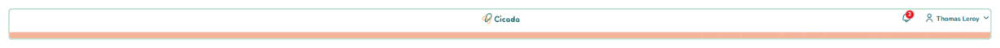
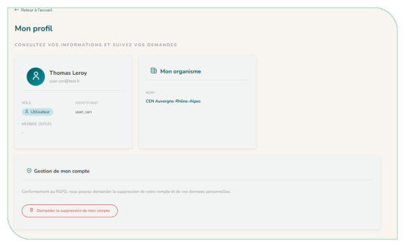
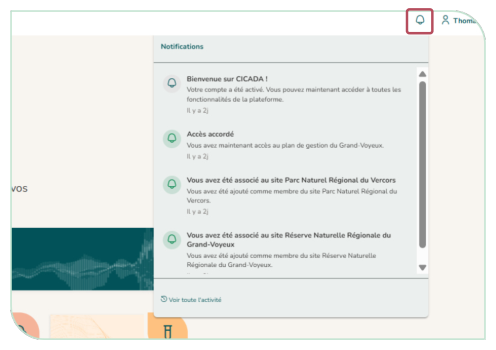
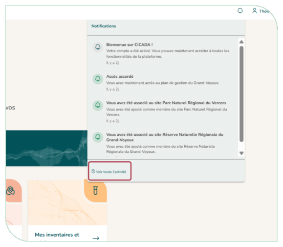
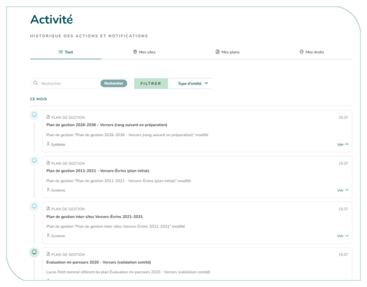
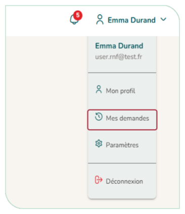
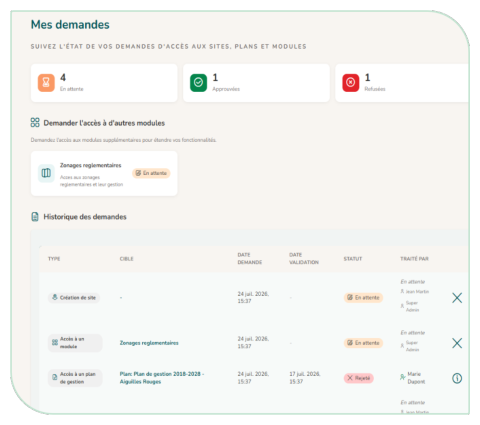

# 3.3. L'en-tête : notification, menu et profil

En haut de chaque page, vous trouvez :

- **Le bouton de menu (à gauche)** : il ouvre le menu latéral (Accueil, Plans de gestion, Sites, Mes inventaires et suivis, Exploration des données…). Si votre instance a défini un logo, il s'affiche à côté.
- **La cloche de notifications** : un compteur indique le nombre de notifications non lues. En cliquant dessus, vous avez accès à toutes vos dernières notifications, que vous pouvez marquer comme lues. Si vous avez des demandes de validation à traiter, elles sont signalées à part, par une pastille rouge et un encart « Validation en attente » dans la liste. Le lien « Voir toute l'activité » ouvre la page « Activité » ([§ 3.3.3](#333-la-page-activité)).
- **Le menu utilisateur** (votre nom, en haut à droite) : il donne accès à « Mon profil », « Mes demandes » et à la « Déconnexion ».

<figure markdown="span">
{ loading=lazy }
<figcaption>Figure 6 : En-tête</figcaption>
</figure>

## 3.3.1. Mon profil

La page « **Mon profil** » (Figure 7) regroupe :

- **Vos informations personnelles :** nom, e-mail, rôle, identifiant, date d'inscription, dernière connexion.
- **Votre organisme** : nom et coordonnées.
- **La gestion de votre compte** : vous pouvez demander la suppression de votre compte (conformément au RGPD).

<figure markdown="span" class="figure--medium">
{ loading=lazy }
<figcaption>Figure 7 : Page « Mon profil »</figcaption>
</figure>

## 3.3.2. Les notifications

CICADA vous informe des événements qui vous concernent (validation d'une demande, association à un site, etc.). Vos notifications se consultent depuis la cloche de l'en-tête ; l'historique complet est disponible sur la page Activité. Vous pouvez marquer un message comme lu, ou tout marquer comme lu d'un seul clic.

<figure markdown="span" class="figure--medium">
{ loading=lazy }
<figcaption>Figure 8 : Onglet notifications</figcaption>
</figure>

## 3.3.3. La page Activité

La page « Activité » accessible via le menu notification ([§ 3.3.2](#332-les-notifications)) retrace, sous forme de fil chronologique, ce qui s'est passé sur votre périmètre (notifications, actions de gestion des droits, etc.). Des onglets vous permettent de filtrer :

- **Tout** : l'ensemble de l'activité visible ;
- **Mes sites** : ce qui concerne vos sites ;
- **Mes plans** : ce qui concerne vos plans ;
- **Mes droits** : l'historique de vos accès (ajouts, retraits, validations)
- **Notifications**.

Les administrateurs disposent d'onglets supplémentaires (Validations, et pour le super administrateur : Système et RGPD).

<figure markdown="span">
{ loading=lazy }
<figcaption>Figure 9 : Onglet notifications - activités</figcaption>
</figure>
<figure markdown="span">
{ loading=lazy }
<figcaption>Figure 10 : Page activités</figcaption>
</figure>

## 3.3.4. Mes demandes d'accès

La page « **Mes demandes** » vous permet de suivre toutes vos demandes : accès à un site, à un plan, à un module, ou inscription. Pour chaque demande, vous voyez son type, sa cible, sa date et son statut (en attente, approuvée, rejetée). Vous pouvez annuler une demande encore en attente.

Tant qu'une demande est en attente, la colonne « Traité par » affiche le nom des personnes qui peuvent la valider (le survol d'un nom indique son rôle et son organisme). Si une demande a été refusée avec un commentaire, une icône d'information permet de le lire.

Cette page liste aussi les **modules** auxquels vous n'avez pas encore accès : un bouton « **Demander l'accès** » ouvre une fenêtre où vous justifiez votre demande.

<figure markdown="span" class="figure--small">
{ loading=lazy }
<figcaption>Figure 11 : Onglet utilisateur - demandes</figcaption>
</figure>
<figure markdown="span">
{ loading=lazy }
<figcaption>Figure 12 : Page Mes demandes</figcaption>
</figure>

