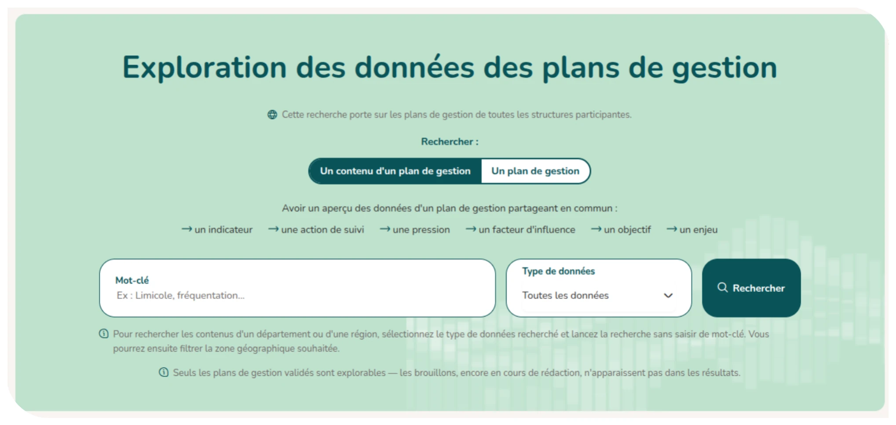
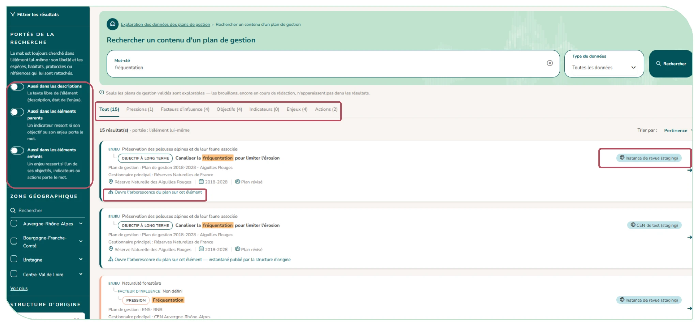

# 3.8. Explorer les données des plans de gestion

Le module Exploration des données (bandeau de l'accueil ou menu latéral) permet de **rechercher dans les plans de gestion validés** (les brouillons n'y figurent pas). Il est ouvert à tout utilisateur connecté.

Un message indique, avant toute recherche, sur quels plans elle porte :

- Si votre instance partage ses plans avec l'exploration nationale, les plans de toutes les instances participantes sont consultables (leur nombre est indiqué) ;
- Sinon, seuls les plans de votre instance sont disponibles. Un encadré le rappelle sur l'accueil de l'exploration et en tête des résultats.

**Deux modes de recherche sont disponibles** :

- « **Un contenu d'un plan de gestion** » : retrouver les enjeux, facteurs d'influence, pressions, objectifs, indicateurs, actions ou suivis qui partagent un mot-clé (ex. « limicole », « fréquentation »). Un **menu « Type de données » restreint** la recherche à un type d'élément. **Pour obtenir les contenus d'un département ou d'une région, choisissez un type de données et lancez la recherche sans mot-clé, puis filtrez sur la zone géographique.**
- « **Un plan de gestion** » : retrouver les plans d'un site, d'un département, d'une région, ou par leur nom.

Les résultats peuvent être triés (pertinence, ordre alphabétique, plus récents) et filtrés.

## Où chercher le mot ?

Le panneau de filtres s'ouvre sur un bloc « **Portée de la recherche** ». **Le mot est toujours cherché dans l'élément lui-même** : son libellé et les espèces, habitats, protocoles ou références qui lui sont rattachés. Trois interrupteurs, chacun accompagné d'une aide, permettent d'élargir le champ de la recherche :

- « **Aussi dans les descriptions** » : recherche dans le texte libre de l'élément (description, état de l'enjeu) ;
- « **Aussi dans les éléments parents** » : recherche dans l'ensemble des éléments parentaux de l'arborescence du plan. Par exemple, un indicateur ressort si son objectif ou son enjeu porte le mot ;
- « **Aussi dans les éléments enfants** » : recherche dans l'ensemble des éléments enfants de l'arborescence du plan. Par exemple, un enjeu ressort si l'un de ses objectifs, indicateurs ou actions porte le mot.

La portée active est rappelée à côté du nombre de résultats.

Chaque résultat indique :

- L'élément retrouvé replacé dans son arborescence (Enjeu › OLT › Niveau d'exigence › Indicateur…) ;
- Pourquoi il répond à la recherche lorsque le mot n'est pas dans son titre (« Trouvé via une espèce, un habitat, un protocole ou une référence rattachée », « Trouvé dans la description », « Trouvé dans un élément parent ou lié », « Trouvé dans un élément enfant », et, en mode « Un plan de gestion », « Trouvé via la zone géographique ») ;
- Le plan, le gestionnaire principal, les sites et la période ;
- En exploration nationale, la structure d'origine ;
- Ce que le clic va ouvrir (« Ouvre la fiche action », « Ouvre l'arborescence du plan sur cet élément », « Ouvre la page du plan de gestion »)

**Le mot cherché est surligné partout où il apparaît** : titre, maillons de l'arborescence, extraits (espèce rattachée, description, élément parent ou enfant), nom du plan et de ses sites. Le mot est surligné en entier, même si vous n'en avez tapé que le début. Ainsi, on voit toujours pourquoi un résultat est sorti.

CICADA tolère les fautes de frappe : si aucun résultat ne correspond exactement, il propose les contenus dont un mot s'approche le plus, et c'est ce mot qui est surligné. Si le mot a été reconnu sous une autre forme (pluriel, conjugaison), le résultat le signale.

## Ouvrir un résultat

Un clic sur un résultat ouvre les écrans habituels de CICADA (la fiche action, l'arborescence du plan dépliée sur l'élément trouvé, ou la page du plan) et non plus une fiche à part. Le mot cherché y reste surligné.

- Si vous avez déjà accès au plan (référent, membre, plan de votre site…), vous le consultez comme d'habitude, avec vos droits.
- Sinon, vous le consultez en lecture seule, avec le bandeau « Consultation via l'exploration des données ». Le budget, les moyens humains, les mesures d'indicateurs, le suivi des réalisations et les personnes ne sont jamais affichés ; les menus Suivis, Exports et Paramétrage sont masqués. **Les documents du plan** (arrêté, avis, version signée…) sont en revanche consultables : un clic les ouvre (PDF, images) ou les télécharge.
- Pour un plan d'une autre structure (exploration nationale), vous voyez l'instantané publié par celle-ci : le bandeau indique qui l'a publié et à quelle date, l'instantané reflétant l'état du plan à ce moment-là. Sa section « **Documents** » (et celle de chaque enjeu qui en porte) liste les documents du plan : un clic ouvre le document directement chez la structure d'origine, dans un nouvel onglet, sans compte sur son instance. Seule l'adresse des documents est publiée, pas les fichiers eux-mêmes.

Le fil d'Ariane (« Exploration des données › structure d'origine › plan ») et les boutons « Retour à l'exploration » ramènent à votre recherche en cours (mot-clé, filtres, page), même plusieurs écrans plus loin.

<figure markdown="span">
{ loading=lazy }
<figcaption>Figure 23 : Exploration des données : page de recherche</figcaption>
</figure>

<figure markdown="span">
{ loading=lazy }
<figcaption>Figure 24 : Exploration des données : page de résultats</figcaption>
</figure>
