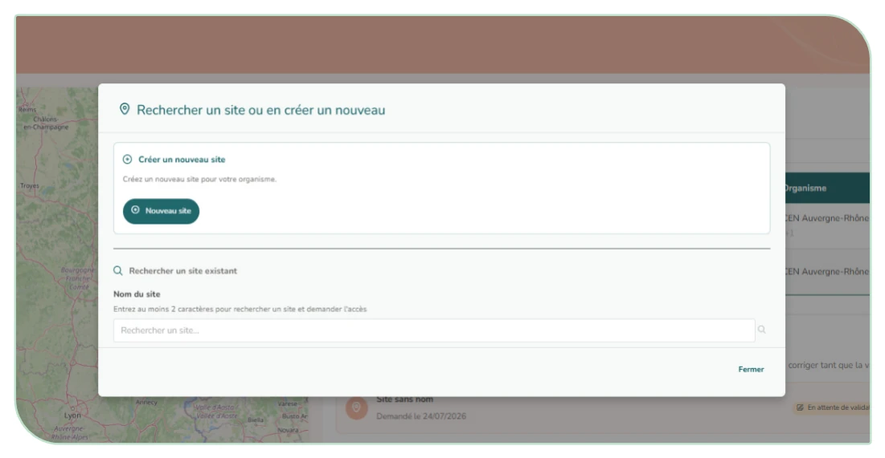
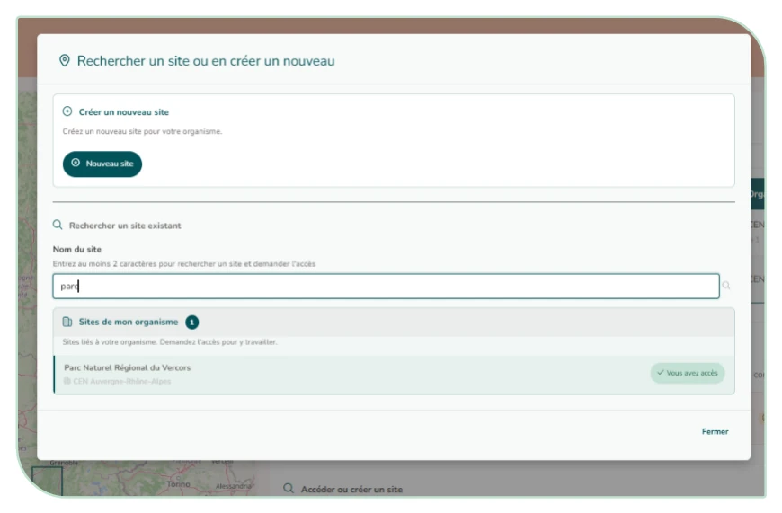
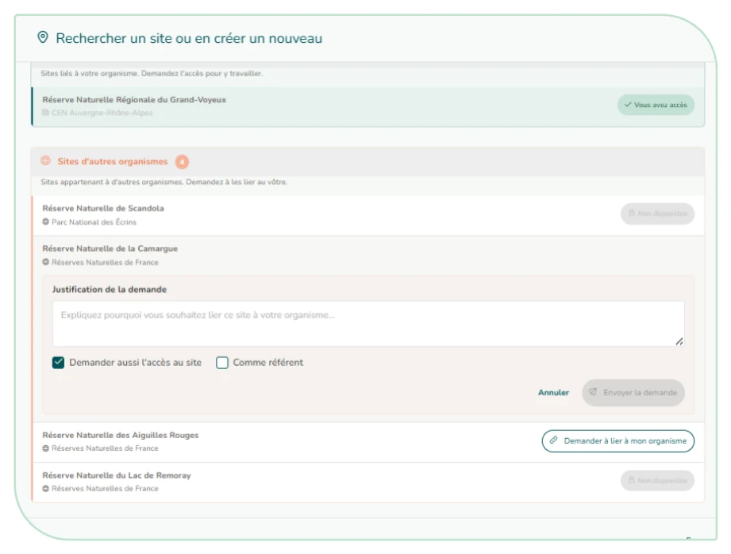
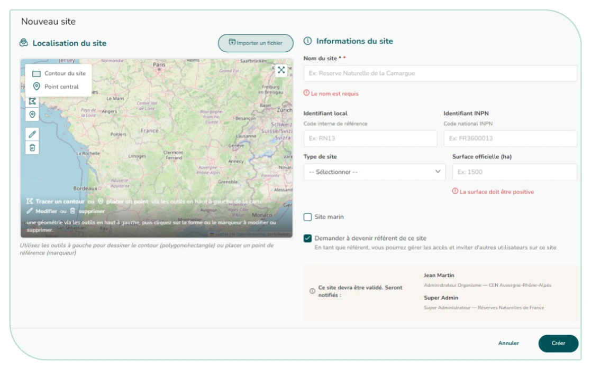
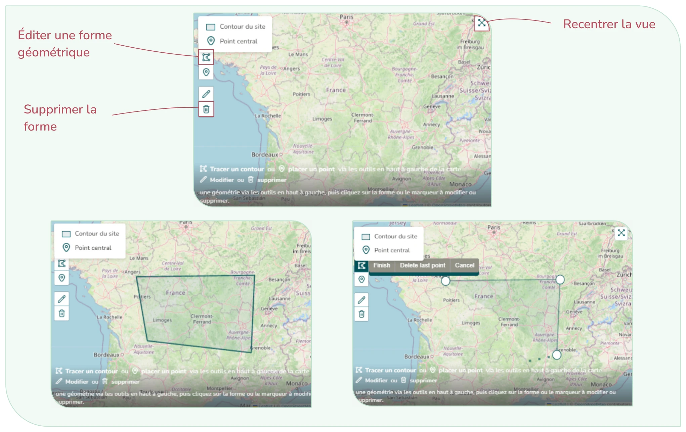

# 3.5. Rejoindre ou créer un nouveau site

Si vous souhaitez avoir accès à un nouveau site, sur la page d'accueil du module « Mes sites », cliquez sur **chercher ou créer un site** (Figure 13).

Dans un premier temps il est nécessaire de vérifier si le site que vous souhaitez ajouter existe déjà ou non dans CICADA. Pour cela, allez dans la fenêtre « **Rechercher un site ou en créer un nouveau** ». Vous pouvez rechercher un site existant (Figure 16) :

<figure markdown="span">
{ loading=lazy }
<figcaption>Figure 15 : Fenêtre rechercher ou créer un nouveau site</figcaption>
</figure>
<figure markdown="span">
{ loading=lazy }
<figcaption>Figure 16 : Rechercher un site existant</figcaption>
</figure>

- Si le site existe déjà au sein de votre organisme mais que vous n'y avez pas accès, vous pouvez **demander l'accès** (simple ou comme référent) (Figure 17) ;
- Si le site existe déjà mais est relié à un autre organisme, vous pouvez demander le **rattachement de votre organisme** (Figure 17) ;
- Si aucun site ne correspond, vous pouvez **créer un nouveau site** (Figure 18)

<figure markdown="span">
{ loading=lazy }
<figcaption>Figure 17 : Demande d'accès à un site</figcaption>
</figure>
<figure markdown="span">
{ loading=lazy }
<figcaption>Figure 18 : Fenêtre de création d'un nouveau site</figcaption>
</figure>

Il existe deux possibilités pour intégrer la donnée géospatiale d'un site lors de sa création :

- Vous pouvez importer le fichier directement – formats acceptés :
    - GeoJSON (.geojson, .json)
    - Shapefile : fichier ZIP contenant .shp, .shx, .dbf et .prj
- Vous pouvez dessiner le contour via les outils d'édition sur la carte (Figure 19).

Cliquez sur éditer une forme géométrique puis cliquez pour ajouter vos points pour délimiter votre zone. Enfin, pour finaliser le contour de votre site, double cliquez sur le dernier point.

<figure markdown="span">
{ loading=lazy }
<figcaption>Figure 19 : Visuels d'édition cartographique de la création d'un site</figcaption>
</figure>
