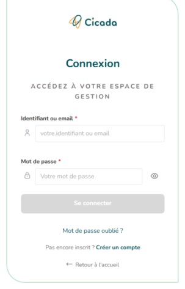
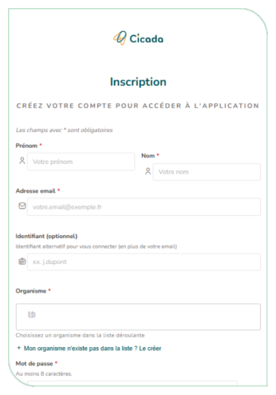
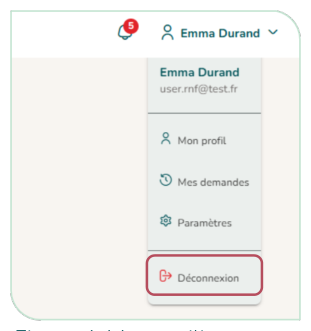

# 3.1. Se connecter

## 3.1.1. Se connecter

Rendez-vous sur la page d'accueil de CICADA et cliquez sur « Se connecter ». Saisissez votre identifiant (ou votre adresse e-mail) et votre mot de passe, puis cliquer sur « Se connecter » (Figure 2).

<figure markdown="span" class="figure--small">
{ loading=lazy }
<figcaption>Figure 2 : Page de connexion</figcaption>
</figure>

## 3.1.2. Créer un compte

Si vous n'avez pas encore de compte, cliquez sur « Créer un compte » depuis l'accueil. Remplissez le formulaire : prénom, nom, e-mail, identifiant, organisme de rattachement, mot de passe. Une zone vous permet de préciser de manière optionnelle le motif de votre demande (Figure 3).

Votre demande n'est pas effective immédiatement : elle doit être validée par un administrateur (organisme ou instance). Une fois le formulaire envoyé, une page vous confirme que votre inscription est en attente. Vous recevrez un e-mail dès que votre compte sera activé.

<figure markdown="span" class="figure--small">
{ loading=lazy }
<figcaption>Figure 3 : Page d'inscription</figcaption>
</figure>

!!! tip "Votre organisme ne figure pas dans la liste proposée ?"

    Cliquez sur « Mon organisme n'existe pas dans la liste ? Le créer » et renseignez son nom (obligatoire) et ses coordonnées. Une demande de création d'organisme est envoyée à l'administrateur, en plus de votre demande de compte.

## 3.1.3. Se déconnecter

Cliquez sur votre nom en haut à droite de l'en-tête ([§ 3.3](en-tete.md)), puis sur « Déconnexion ».

<figure markdown="span" class="figure--small">
{ loading=lazy }
<figcaption>Figure 4 : Menu utilisateur</figcaption>
</figure>
