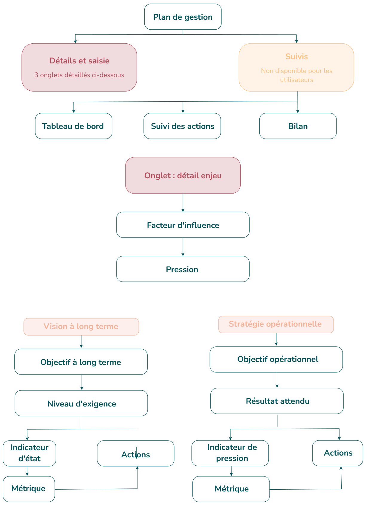

# 3.7. Comprendre la structure d'un plan de gestion

Un plan de gestion s'organise en **arborescence**, qui suit la méthode d'élaboration des plans de gestion **CT88**. Comprendre cette hiérarchie est indispensable pour saisir dans le bon ordre.

<figure markdown="span" class="figure--medium">
{ loading=lazy }
<figcaption>Structure d'un plan de gestion</figcaption>
</figure>

| Terme | Définition |
|-------|------------|
| **Enjeu** | Les enjeux sont constitués des éléments du patrimoine (naturel, géologique ou culturel) ou du fonctionnement (écologique ou socio-économique) de l'ENP pour lesquels ce dernier a une responsabilité et que l'on doit préserver ou améliorer. C'est ce qui justifie la désignation de l'ENP au vu de ses finalités de création <small>NB : Pour certaines aires protégées, les enjeux socio-économiques ne sont pas une finalité. Les aspects socio-économiques conditionnant fortement la réussite de la mission de protection du patrimoine naturel, sont intégrées sous la notion de facteur clé de réussite</small> |
| **Facteur clé de réussite (FCR)** | Condition transversale nécessaire à la réussite de la gestion |
| **Facteur d'influence** | Élément ou phénomène (naturel ou anthropique) agissant favorablement ou défavorablement sur l'enjeu. |
| **Pression** | Action ou phénomène concret et observable qui matérialise un facteur défavorable. |
| **Objectif à long terme (OLT)** | État souhaité de l'enjeu à long terme |
| **Niveau d'exigence** | Seuil mesurable précisant à quel point l'OLT doit être atteint. |
| **Indicateur d'état** | Paramètre mesurable renseignant sur l'état de conservation de l'enjeu. |
| **Métrique** | Mesure concrète d'un indicateur (avec unité, état de référence et seuils de score). |
| **Indicateur de pression** | Paramètre mesurable renseignant sur une pression s'exerçant sur un enjeu |
| **Objectif opérationnel (OO)** | Objectif concret à atteindre pour répondre à une pression. |
| **Résultat attendu** | Résultat précis attendu d'un objectif opérationnel. |
| **Action** | Intervention de gestion programmée (type, calendrier, budget, partenaires…). |

<em style="color:#025359;font-size:0.78rem">Figure 22 : Définitions principales de la méthode CT88</em>

