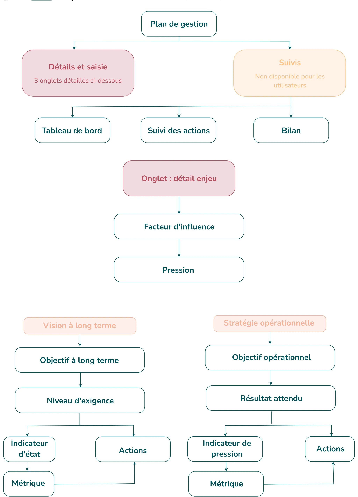

# 3.7. Comprendre la structure d'un plan de gestion

Un plan de gestion s'organise en **arborescence**, qui suit la méthode d'élaboration des plans de gestion **CT88**. Comprendre cette hiérarchie est indispensable pour saisir dans le bon ordre.

<figure markdown="span" class="figure--medium">
{ loading=lazy }
<figcaption>Structure d'un plan de gestion</figcaption>
</figure>

| Terme | Définition |
|-------|------------|
| **Enjeu** | C'est ce qui est en jeu (à perdre ou à gagner). C'est ce qui est important et justifie l'existence de l'AP (finalités, défis à relever), ce qui a été identifié comme remarquable et à préserver, pour lesquels l'AP a une responsabilité particulière. Il s'agit de ce sur quoi il faut veiller ou agir afin d'éviter le risque de les perdre ou de devoir les regagner. Dans les aires protégées, les enjeux peuvent être écologiques, paysagers, socio-économiques. Ils sont le plus souvent rédigés à l'aide d'une phrase nominale et sont par nature peu nombreux et intégrateurs. |
| **Facteur clé de réussite (FCR)** | Nom donné aux enjeux transversaux qui conditionnent la bonne réussite de la mission de base du gestionnaire. Ils sont identifiés lors de l'état des lieux et concernent l'acquisition de connaissances, la gouvernance, l'ancrage territorial… Ils sont spécifiques aux aires protégées pour lesquels les enjeux socio-économiques ne sont pas une finalité. |
| **Facteur d'influence** | Facteurs naturels et anthropiques qui agissent de façon directe ou indirecte sur l'existence, l'état et l'évolution des enjeux et/ou les choix de gestion sur le site. Dans le cadre DPSIR, les facteurs d'influence correspondent au D (Driving forces = Forces motrices) et sont les activités (au sens large) humaines à l'origine des pressions, ce sont en quelque sorte les causes des pressions. |
| **Pression** | Une pression (P) est une conséquence négative directe, la manifestation sur le terrain d'un ou d'une succession de facteurs d'influence. <em>Astuce : on répond ici à la question « Qu'est-ce qui cause directement la dégradation, le dommage constaté pour un enjeu ? ».</em> |
| **Objectif à long terme (OLT)** | État ou fonctionnement que l'on vise sur le long terme pour un enjeu particulier au regard d'une situation actuelle. L'objectif à long terme donne une vision claire du cap que l'on se fixe pour un enjeu. Il exprime ce que l'on veut ATTEINDRE. C'est une décision « politique » qui engage les parties prenantes de la gestion sur le long terme. Elle est issue d'un croisement des différents enjeux et répond aux obligations de l'aire protégée. Ils sont assortis d'un niveau d'exigence assurant leur évaluation. En général, il y a un seul objectif à long terme par enjeu. |
| **Niveau d'exigence** | Il définit l'ensemble des conditions à remplir par enjeu afin de fixer et détailler l'ambition des objectifs à long terme (croisement de l'écologiquement et du politiquement faisable). C'est la cible à atteindre (valeurs / cibles visées) qui sera utilisée pour évaluer l'évolution de l'état de chaque enjeu et donc le niveau d'atteinte des objectifs à long terme. |
| **Indicateur d'état** | Cet indicateur mesure l'état d'un enjeu à un instant donné. Par la mesure de la progression vers des niveaux d'exigence préalablement définis, il contribue à évaluer l'atteinte de l'objectif à long terme (OLT) rédigé pour un enjeu. Il est renseigné la plupart du temps à partir de suivis scientifiques qui doivent être le plus possible sanctuarisés sur le plan technique, humain et financier. <em>Astuce : on répond ici à la question « Est-ce que l'état de l'enjeu évolue dans le sens souhaité et conséquemment est-ce que nous progressons vers l'objectif à long terme ? »</em> |
| **Métrique** | Mesure (distribution, abondance, longueur moyenne par exemple) ou indice (diversité taxonomique, richesse fonctionnelle, biomasse totale par exemple) calculé à partir de données collectées ou issu de modélisation permettant de renseigner un indicateur (exemple : le niveau et les battements de la nappe phréatique pour évaluer le fonctionnement d'une nappe souterraine). Chaque indicateur est construit en combinant une ou plusieurs métriques. |
| **Indicateur de pression** | Cet indicateur mesure le niveau de la pression à un instant donné. Il traduit l'efficacité des efforts mis en œuvre pour agir sur une pression et, par la mesure de la progression vers les résultats attendus préalablement définis, il contribue à évaluer l'atteinte de l'objectif opérationnel (OO) auquel il est rattaché. <em>Astuce : on répond ici à la question « Est-ce que la pression varie dans le sens souhaité et conséquemment est-ce que nous progressons vers l'objectif opérationnel ? »</em> |
| **Objectif opérationnel (OO)** | Choix opérationnels pour agir concrètement durant le plan de gestion, à court et moyen termes, établis au regard de l'analyse des facteurs qui influencent les enjeux. Les objectifs opérationnels font le lien entre les pressions identifiées et les actions de terrain. Il peut y avoir plusieurs objectifs opérationnels pour une pression identifiée. Ils sont assortis d'un résultat attendu permettant la mesure de l'efficacité des opérations qui en découlent. L'ensemble des OO doit permettre de progresser vers l'atteinte des OLT. <em>Astuce : on répond ici à la question « Qu'allons-nous faire pour améliorer la situation ? ».</em> |
| **Résultat attendu** | Le résultat attendu désigne les conditions ou exigences à remplir (un certain niveau de pression acceptable) pour atteindre les objectifs opérationnels dans la durée du plan et qui permettra de juger de leur atteinte. |
| **Action** | C'est un ensemble organisé d'opérations dans le but de modifier une situation problématique (gestion des pressions). La distinction entre une « action de gestion » et une « opération de gestion » est subtile et souvent utilisée de manière interchangeable, mais il existe des nuances importantes : — une **action de gestion** est une démarche globale qui implique une prise de décision et une intention de modifier ou d'influencer une situation (par exemple : mise en place du pâturage, sensibilisation des usagers) ; — une **opération de gestion** est une tâche concrète, une activité spécifique qui contribue à la réalisation d'une action de gestion. Elle est souvent plus ciblée et a un impact plus immédiat (par exemple : installation de clôtures et convention avec un agriculteur pour le pâturage ; création et diffusion de documents, animations sur le terrain pour la sensibilisation des usagers). |

<em style="color:#025359;font-size:0.78rem">Figure 22 : Définitions principales de la méthode CT88</em>

